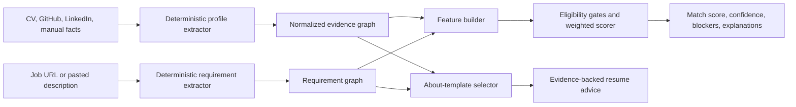

# No-OpenAI Fit Model — Design

## Design principles

1. **Extract facts, then score:** raw keyword overlap is not enough.
2. **Evidence strength matters:** professional use, projects, coursework, and self-report are different signals.
3. **Hard requirements can cap a score:** missing a blocker cannot be cancelled by many weak matches.
4. **Fit and confidence are separate:** incomplete data lowers confidence; it must not silently become a low fit.
5. **No fabricated resume text:** every inserted claim must map to stored evidence.
6. **Version everything:** ontology, extractor, scoring formula, and template must be reproducible.

## Processing flow



## Profile and job extraction

### Skill ontology

Replace the current short technology list with a versioned ontology containing:

- Canonical skill: `postgresql`.
- Aliases: `postgres`, `postgre sql`.
- Parent/child relationships: `sql` → `postgresql`, `mysql`, `sqlite`.
- Related but non-equivalent skills: `c` ↔ `c++`, `react` ↔ `next.js`.
- Domain: embedded, backend, frontend, mobile, data, ML, cloud, QA, security.
- Evidence context: used professionally, used in a project, studied, mentioned only.
- Last-used date or recency when it can be inferred safely.

Aliases may establish recognition, but related skills receive partial credit rather than being treated as exact matches.

### Requirement classification

Each requirement is stored as:

- `category`: skill, years, seniority, education, responsibility, domain, language, location, work mode, work authorization, availability.
- `priority`: blocker, must-have, strong preference, nice-to-have.
- `value`: normalized requirement.
- `evidence`: source sentence from the posting.
- `confidence`: extraction confidence.

Section headings and wording determine priority. “Required”, “must”, and “minimum” are strong signals; “preferred”, “advantage”, and “bonus” are weaker signals. Requirements inferred only from responsibilities receive lower confidence than explicitly listed qualifications.

### Candidate evidence levels

| Evidence | Base strength | Notes |
|---|---:|---|
| Confirmed professional use | 1.00 | Employment or internship evidence with context |
| Substantial project | 0.80 | Project description shows implementation, scope, or outcome |
| Academic project/coursework | 0.55 | Relevant but not professional experience |
| GitHub repository signal | 0.50–0.80 | Depends on README/code metadata and role relevance |
| User-approved self-report | 0.45 | Valid fact, but limited independent evidence |
| Unapproved keyword mention | 0.25 | Weak until clarified |

Recency and relevance multiply the base strength. Academic and personal projects can prove skills, but they never add professional years.

## Match model v2

### Weighted score before caps

| Component | Weight |
|---|---:|
| Must-have skill evidence | 30 |
| Relevant professional/project evidence | 25 |
| Required years and seniority | 20 |
| Responsibility and domain alignment | 10 |
| Preferred and nice-to-have skills | 5 |
| Education/language requirements | 5 |
| Location, work mode, authorization, availability | 5 |

The model begins at zero and earns points. Missing explicit requirements then apply penalties and caps; weak unrelated matches cannot inflate the result.

### Initial eligibility caps

These values are starting policy and must be calibrated against a reviewed test set:

- Zero confirmed professional years when at least one year is explicitly required: maximum 45.
- Candidate below required experience by more than one year: maximum 55.
- Senior/lead role without senior-level evidence: maximum 35.
- One missing critical must-have: maximum 65.
- Two or more missing critical must-haves: maximum 45.
- Explicit work-authorization blocker: maximum 35.
- Hard location/availability mismatch: maximum 45.
- Required degree/field absent: maximum 60; no cap when the degree is only preferred.

A cap affects the score but remains visible as a named blocker. Multiple caps use the lowest applicable maximum.

### Factors that should affect matching

- Exact, alias, and transferable-skill coverage.
- Requirement priority and extraction confidence.
- Professional years, internship duration, and career stage.
- Evidence type, depth, relevance, and recency.
- Project complexity: ownership, architecture, testing, deployment, users, scale, or measurable outcome.
- Responsibility alignment, not just technology overlap.
- Domain experience: embedded, regulated systems, fintech, healthcare, SaaS, and similar contexts.
- Education only when the posting makes it relevant.
- Languages required for the workplace or role.
- Location, remote/onsite expectations, work authorization, availability, and semesters remaining.
- Contradictions and missing facts, which trigger clarification or lower confidence.
- User preferences such as role type and location, shown as a separate **interest fit** rather than mixed into qualification fit.

### Factors explicitly excluded

- Name, age, gender, photograph, ethnicity, religion, marital/family status, disability, or health.
- School prestige.
- GitHub follower/star totals or raw commit volume.
- Resume formatting quality as a qualification signal.
- Company popularity or the number of applicants.

### Output

```json
{
  "model_version": "fit-v2.0.0",
  "ontology_version": "skills-v1.0.0",
  "score": 67,
  "confidence": 0.84,
  "fit_level": "medium",
  "component_scores": {},
  "applied_caps": [],
  "matched_evidence": [],
  "missing_blockers": [],
  "weaker_gaps": [],
  "clarification_questions": []
}
```

## About-template engine

### Template selection dimensions

Template selection should consider:

- Career stage: student, intern, new graduate, junior, mid-level, senior, career changer.
- Role family: embedded, backend, frontend, full-stack, mobile, data, ML, cloud/DevOps, QA, security, research.
- Strongest evidence: professional work, projects, education, open source, domain expertise.
- Job emphasis: technical depth, product delivery, reliability, ownership, research, collaboration, customer impact.
- Evidence completeness and confidence.
- Desired length: short 35–50 words or standard 50–75 words.
- User tone preference: direct, technical, product-oriented, or academic.

### Supported placeholders

| Placeholder | Meaning | Rule |
|---|---|---|
| `<ABOUT_ME>` | User-approved personal positioning | Never inferred from protected information |
| `<ROLE_TITLE>` | Target role | Normalized from posting |
| `<CAREER_STAGE>` | Student, junior, etc. | Evidence-backed |
| `<SKILLS>` | Three to five top relevant skills | Evidence-backed and job-priority ordered |
| `<TOOLS>` | Relevant tools/platforms | Optional |
| `<DOMAIN>` | Embedded, backend, fintech, etc. | Optional |
| `<EDUCATION_STATUS>` | Degree and field | Optional |
| `<SEMESTERS_LEFT>` | Remaining semesters | Student templates only |
| `<YEARS_EXPERIENCE>` | Confirmed professional years | Never derived from project duration |
| `<PROJECT_HIGHLIGHT>` | Most relevant project | Must have source evidence |
| `<PROJECT_IMPACT>` | Verified result or outcome | Omit if no metric/outcome exists |
| `<STRENGTHS>` | Evidence-supported strengths | Avoid generic adjectives |
| `<OPEN_SOURCE_HIGHLIGHT>` | Relevant public contribution | Optional |
| `<INDUSTRY>` | Relevant industry context | Optional |
| `<CAREER_GOAL>` | User-approved target | Optional |
| `<AVAILABILITY>` | Internship/student availability | Optional |
| `<LANGUAGES>` | Relevant spoken languages | Only when useful for the role |

`<TARGET_COMPANY>` is intentionally excluded from default About text. A resume summary normally reads better when tailored to the role and domain without naming one company.

### Template catalog (24)

Each template is a sentence pattern, not permission to fabricate a value. Optional clauses disappear cleanly when their value is missing.

#### T01 — Student, general software

`<ABOUT_ME>. <EDUCATION_STATUS> with <SEMESTERS_LEFT> remaining and hands-on project experience in <SKILLS>. Built <PROJECT_HIGHLIGHT>, demonstrating <STRENGTHS>, and seeking a <ROLE_TITLE> opportunity focused on <DOMAIN>.`

#### T02 — Student, technical

`<CAREER_STAGE> developer with evidence-backed knowledge of <SKILLS> and a focus on <DOMAIN>. Seeking a <ROLE_TITLE> position where practical engineering fundamentals and <STRENGTHS> can support reliable software delivery.`

#### T03 — Student, availability-led

`<ABOUT_ME>, currently completing <EDUCATION_STATUS> with <SEMESTERS_LEFT> remaining. Available <AVAILABILITY> and experienced in building projects with <SKILLS>, including <PROJECT_HIGHLIGHT>. Interested in contributing these skills as a <ROLE_TITLE>.`

#### T04 — Internship candidate

`<EDUCATION_STATUS> candidate seeking a <ROLE_TITLE> internship, with applied experience in <SKILLS>. Through <PROJECT_HIGHLIGHT>, developed <STRENGTHS> and practical familiarity with <TOOLS>, with a focus on learning and contributing in <DOMAIN>.`

#### T05 — New graduate

`New graduate in <EDUCATION_STATUS> with project-based experience in <SKILLS>. Delivered <PROJECT_HIGHLIGHT><PROJECT_IMPACT> and developed strengths in <STRENGTHS>. Seeking a <ROLE_TITLE> role in <DOMAIN> where this foundation can translate into production impact.`

#### T06 — Junior software engineer

`Junior software developer with evidence-backed experience in <SKILLS> and a focus on <DOMAIN>. Built <PROJECT_HIGHLIGHT><PROJECT_IMPACT>, demonstrating <STRENGTHS>. Looking to contribute as a <ROLE_TITLE> while continuing to deepen production engineering experience.`

#### T07 — Project-led, no professional experience

`<ABOUT_ME> with strong project-based experience in <SKILLS>. Designed and implemented <PROJECT_HIGHLIGHT><PROJECT_IMPACT>, providing practical evidence of <STRENGTHS>. Seeking a <ROLE_TITLE> role where demonstrated ability can grow into professional experience.`

#### T08 — Backend

`Backend-focused <CAREER_STAGE> developer experienced with <SKILLS>. Built <PROJECT_HIGHLIGHT> using <TOOLS><PROJECT_IMPACT>, with emphasis on <STRENGTHS>. Targeting a <ROLE_TITLE> position involving reliable APIs, data systems, and <DOMAIN>.`

#### T09 — Frontend

`Frontend-focused <CAREER_STAGE> developer working with <SKILLS>. Created <PROJECT_HIGHLIGHT><PROJECT_IMPACT>, demonstrating <STRENGTHS> across interface implementation and application behavior. Seeking a <ROLE_TITLE> role building clear, reliable user experiences in <DOMAIN>.`

#### T10 — Full-stack

`Full-stack <CAREER_STAGE> developer with practical experience across <SKILLS>. Delivered <PROJECT_HIGHLIGHT> using <TOOLS><PROJECT_IMPACT>, showing <STRENGTHS> from data and API design through user-facing implementation. Interested in a <ROLE_TITLE> role with end-to-end ownership.`

#### T11 — Embedded and firmware

`Embedded-software <CAREER_STAGE> developer with experience in <SKILLS>. Built <PROJECT_HIGHLIGHT><PROJECT_IMPACT>, demonstrating <STRENGTHS> in low-level development, debugging, and system behavior. Seeking a <ROLE_TITLE> role focused on dependable <DOMAIN> products.`

#### T12 — Mobile

`Mobile-focused <CAREER_STAGE> developer experienced in <SKILLS>. Developed <PROJECT_HIGHLIGHT> with <TOOLS><PROJECT_IMPACT>, building strengths in <STRENGTHS>. Targeting a <ROLE_TITLE> position delivering stable, user-centered mobile applications.`

#### T13 — Data engineering

`Data-focused <CAREER_STAGE> developer with hands-on experience in <SKILLS>. Implemented <PROJECT_HIGHLIGHT><PROJECT_IMPACT>, demonstrating <STRENGTHS> in data processing, storage, and reliability. Seeking a <ROLE_TITLE> role supporting trustworthy data systems in <DOMAIN>.`

#### T14 — Machine learning

`Machine-learning <CAREER_STAGE> candidate with applied experience in <SKILLS>. Developed <PROJECT_HIGHLIGHT><PROJECT_IMPACT>, showing strengths in <STRENGTHS> and responsible evaluation. Interested in a <ROLE_TITLE> role applying ML methods to practical <DOMAIN> problems.`

#### T15 — Cloud and DevOps

`Cloud and automation-focused <CAREER_STAGE> engineer experienced with <SKILLS>. Built <PROJECT_HIGHLIGHT> using <TOOLS><PROJECT_IMPACT>, demonstrating <STRENGTHS> in deployment, observability, and repeatable operations. Seeking a <ROLE_TITLE> position improving delivery and reliability.`

#### T16 — QA and test automation

`Quality-focused <CAREER_STAGE> engineer with experience in <SKILLS>. Created <PROJECT_HIGHLIGHT><PROJECT_IMPACT>, demonstrating <STRENGTHS> in test design, automation, and defect prevention. Targeting a <ROLE_TITLE> role that values reliable software and measurable quality.`

#### T17 — Cybersecurity

`Security-focused <CAREER_STAGE> candidate experienced in <SKILLS>. Completed <PROJECT_HIGHLIGHT><PROJECT_IMPACT>, providing evidence of <STRENGTHS> in secure implementation and technical investigation. Seeking a <ROLE_TITLE> role protecting systems in <DOMAIN>.`

#### T18 — Research and algorithms

`<EDUCATION_STATUS> candidate focused on <DOMAIN>, with experience in <SKILLS>. Through <PROJECT_HIGHLIGHT><PROJECT_IMPACT>, demonstrated <STRENGTHS> in analytical problem-solving, experimentation, and implementation. Interested in a <ROLE_TITLE> role connecting rigorous analysis with working software.`

#### T19 — Open-source-led

`<CAREER_STAGE> developer with practical experience in <SKILLS> and public work through <OPEN_SOURCE_HIGHLIGHT>. Contributions demonstrate <STRENGTHS> and familiarity with collaborative engineering workflows. Seeking a <ROLE_TITLE> role in <DOMAIN>.`

#### T20 — Product-oriented engineer

`Product-minded <CAREER_STAGE> engineer experienced in <SKILLS>. Delivered <PROJECT_HIGHLIGHT><PROJECT_IMPACT>, balancing implementation with <STRENGTHS>. Seeking a <ROLE_TITLE> role where technical decisions connect directly to useful and reliable product outcomes.`

#### T21 — Startup ownership

`Adaptable <CAREER_STAGE> engineer with hands-on experience across <SKILLS>. Took ownership of <PROJECT_HIGHLIGHT><PROJECT_IMPACT>, demonstrating <STRENGTHS> from problem definition through delivery. Interested in a <ROLE_TITLE> role requiring broad contribution and fast iteration.`

#### T22 — Enterprise reliability

`Software engineer with <YEARS_EXPERIENCE> of confirmed experience in <SKILLS>. Contributed to <PROJECT_HIGHLIGHT><PROJECT_IMPACT>, with strengths in <STRENGTHS>, maintainability, and dependable delivery. Targeting a <ROLE_TITLE> position supporting reliable systems in <INDUSTRY>.`

#### T23 — Experienced specialist

`<ROLE_TITLE> candidate with <YEARS_EXPERIENCE> of professional experience focused on <DOMAIN> and <SKILLS>. Delivered <PROJECT_HIGHLIGHT><PROJECT_IMPACT>, demonstrating <STRENGTHS>. Brings relevant <INDUSTRY> context and a record of evidence-backed technical contribution.`

#### T24 — Career changer

`<ABOUT_ME> transitioning into <DOMAIN> with focused experience in <SKILLS>. Built <PROJECT_HIGHLIGHT><PROJECT_IMPACT> and developed <STRENGTHS> through practical work and <EDUCATION_STATUS>. Seeking a <ROLE_TITLE> opportunity where transferable experience and demonstrated technical ability are relevant.`

### Rendering rules

1. Choose a template only if every required placeholder is available.
2. Rank candidate facts by approval, evidence strength, relevance, and recency.
3. Insert no more than five skills and one primary project.
4. Render `<PROJECT_IMPACT>` as a grammatically complete optional clause such as `, reducing processing time by 30%`; otherwise render an empty string.
5. Normalize whitespace and punctuation after removing optional clauses.
6. Target 45–75 words and reject output outside 30–90 words.
7. Run a final unresolved-token check; any `<...>` token is a rendering failure.
8. Return the template ID and evidence IDs with the generated text.

## Confidence and clarification

Confidence is computed from:

- CV text extraction quality.
- Job-description completeness.
- Percentage of important requirements with an explicit source sentence.
- Percentage of candidate claims with approved evidence.
- Agreement or conflict between CV, GitHub, LinkedIn, and manual facts.

Low confidence does not directly lower qualification fit. It produces clarification questions and a warning that the score may change.

## Future trained model

Store outcome events and feature snapshots now, but retain deterministic scoring until there is enough consented, reviewed data. A future first model should be regularized logistic regression or gradient boosting—not a neural network—because the features are structured and explanations are required.

Training should not begin until there are at least several hundred usable outcome-labeled matches with reasonable class balance. “Applied” is not a positive label. Interview progression can be a weak label; offer is a stronger but rarer label. Offline evaluation must compare against the deterministic baseline and measure calibration and false-high-match results.
