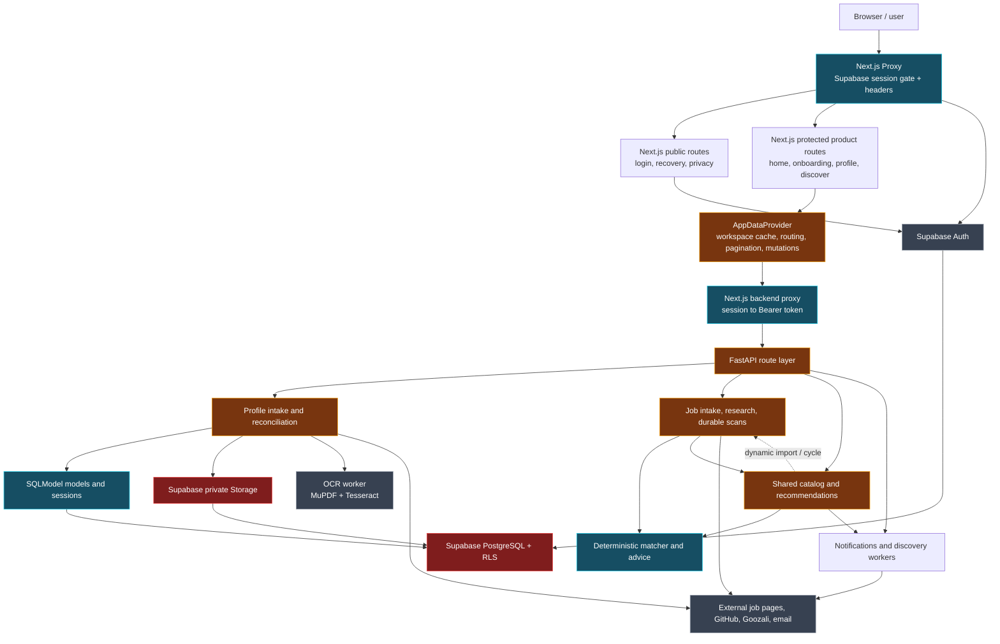
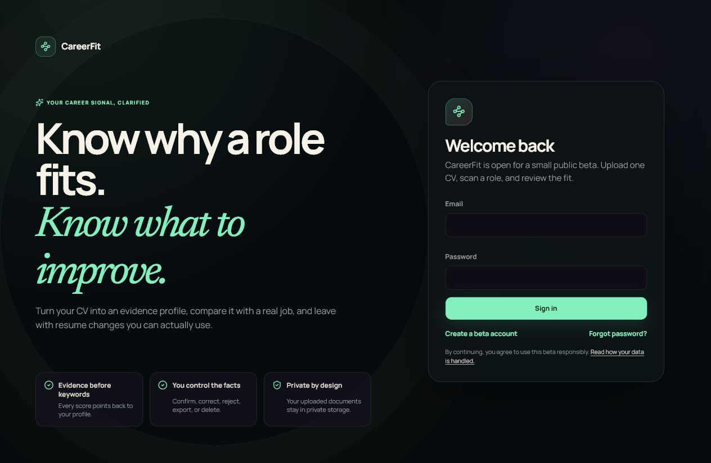
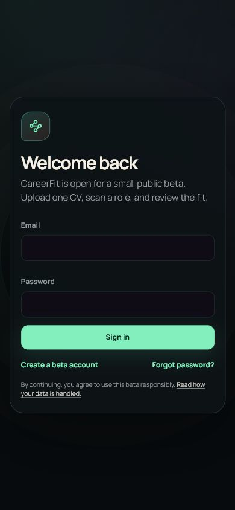
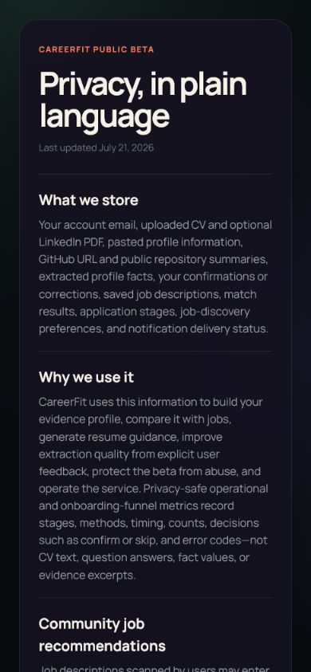
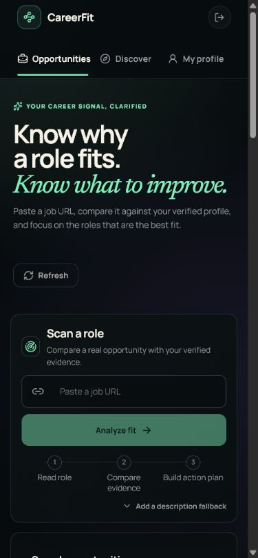
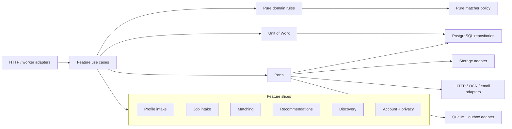

# CareerFit full-stack product and production-readiness audit

**Date:** 2026-07-28  
**Mode:** Architecture Audit  
**Scope:** All 182 tracked repository files, commit history, frontend, FastAPI API, OCR worker, Supabase schema and migrations, data tooling, tests, deployment configuration, documentation, dependencies, and read-only live product flows  
**Health Score:** **38/100**  
**Trend:** First run — no trend data  
**Release recommendation:** **Do not broaden the public beta until the P0 findings are closed.**

CareerFit has a thoughtful evidence-first product idea, a coherent interface, and a meaningful body of deterministic parsing and matching tests. It is not yet a safe, repeatable production system. A real pagination endpoint currently falls through without returning a response; the documented database bootstrap and migration order are invalid; tenant ownership is not enforced across parent-child foreign keys; authenticated clients can forge server-derived records; pasted job content is silently copied into a shared catalog; and important auth, file-retention, dependency, and release-control gaps remain.

The score uses the Brooks-Lint balanced rubric over ten grouped systemic findings: `100 − (2 critical × 15) − (6 warnings × 5) − (2 suggestions × 1) = 38`. It is a production-readiness signal, not a claim that only 38% of the code works.

---

## Module Dependency Graph

The intended shape is a modular monolith, which is appropriate at this stage. The current implementation, however, has too much coordination in the route layer, a bidirectional Jobs ↔ Recommendations dependency, browser-side ownership of server state and workflow rules, and several storage/database boundaries that do not enforce the assumptions made by application code.

---

## Executive decision

### What is already good

- The core proposition—an inspectable, deterministic match based on approved evidence rather than opaque AI scoring—is differentiated and responsibly framed.
- Match confidence is kept separate from score, missing information becomes a clarification path, and hard blockers cap scores.
- The visual language is coherent across desktop and mobile. The tested pages did not horizontally overflow at 390 × 844 or 1280 × 720.
- The backend has trace IDs, timing, privacy-conscious logging, no-store behavior in sensitive paths, security headers, durable scan concepts, and client-deny policies for internal metrics.
- Authenticated account export and typed-confirmation deletion are present.
- TypeScript typechecking, the production frontend build, 162 backend tests, and three OCR tests pass.
- No credible committed credential was found in tracked files or reachable history.

### Why release should pause

The main risk is not visual polish. It is that the product's trust promise is stronger than the guarantees currently implemented:

1. A core BFF endpoint has a confirmed missing return.
2. A new database cannot be built correctly from the documented path.
3. RLS checks the child row's `user_id`, not whether its referenced parent belongs to that user.
4. Browser credentials can directly mutate records that the product presents as backend-derived.
5. Every analyzed user job can become shared recommendation content, including pasted or private descriptions.
6. File upload and account deletion do not cover old, orphaned, or directly uploaded objects.
7. There is no CI, no HTTP contract suite, no PostgreSQL/RLS suite, no frontend tests, and the production smoke test is stale.

### Immediate release gates

| Priority | Gate | Exit criterion |
|---|---|---|
| P0 | Restore the job-summary page contract | Route returns a typed page and ETag/304 behavior is covered through HTTP tests |
| P0 | Make database deployment deterministic | One monotonic migration chain passes a clean Supabase reset and an upgrade test |
| P0 | Enforce tenant graph ownership | Hostile two-user PostgreSQL tests cannot attach children to another user's parents |
| P0 | Protect derived records | Browser roles cannot create or rewrite matches, advice, model versions, histories, or evaluation labels |
| P0 | Stop undisclosed shared catalog ingestion | Pasted/private jobs never enter the shared catalog; public contribution requires explicit, contextual consent |
| P0 | Close auth/configuration fail-open paths | Callback redirect is same-origin, production cannot start in dev-auth mode, and missing frontend auth config fails closed |
| P0 | Make file deletion complete and recoverable | Replacement, parse failure, direct upload, and account deletion leave no orphaned object; deletion retries are durable |
| P1 | Establish a release pipeline | CI blocks on tests, lint/typecheck, audits, migrations/RLS, container scan, and staging smoke |
| P1 | Stabilize client state and workflows | Auth/onboarding routing is server-enforced; concurrent mutations, cache failures, scans, and profile saves are deterministic |
| P1 | Meet an accessibility baseline | Keyboard tabs, labels, focus restoration, dialog semantics, contrast, target sizes, and automated axe checks pass |
| P1 | Validate score semantics | A frozen, diverse, human-reviewed benchmark replaces the automated “reviewed” baseline |

---

## Scope, method, and limits

### Repository coverage

- **182 tracked files**: backend 66, frontend 56, Supabase 17, product/spec files 12, docs 11, OCR worker 8, datasets 7, and root configuration.
- **25,213 text lines** across 180 non-binary tracked files, excluding the lockfile and approved image assets from line counting.
- **39 commits**, one contributor, ten active development dates, and approximately 32,802 additions / 2,608 deletions from 2026-07-04 through 2026-07-25.
- Full inventory and cross-layer dependency review, targeted runtime proofs, source-history/blame review, dependency and secret checks, and a read-only live product walkthrough.

### Verification run

| Area | Result |
|---|---|
| Backend tests | **162 passed** |
| OCR tests | **3 passed**; five PyMuPDF SWIG deprecation warnings |
| Frontend typecheck | **Passed** |
| Frontend production build | **Passed**; 14 routes generated |
| Browser console during audited flows | **0 errors, 0 warnings** |
| `npm ls --depth=0` | Clean dependency tree |
| `npm audit --omit=dev` | **3 high**, 0 critical package entries |
| Python package consistency | `pip check` passed, but the local environment contains undeclared packages and is not a clean reproducibility proof |
| Secret review | No credible tracked secret; no tracked `.env`/`.env.local` in reachable history |
| Job summary runtime proof | Direct in-memory service/route-path check confirmed the handler returns `None` |

### Live product walkthrough

The live site was exercised in the user's chosen in-app browser at desktop and mobile sizes. An existing authenticated session was used only for read-only navigation. Tested flows included:

- Login, signup-mode and recovery-mode switching, native empty-form validation, and responsive behavior.
- Authenticated navigation to home, profile, onboarding, discover, and privacy.
- Authenticated access to `/login`.
- Onboarding guard behavior for an already-onboarded account.
- Opportunity-inspector tab keyboard behavior.
- Discovery-off career-interest controls.
- Mobile page length, label relationships, target dimensions, and horizontal overflow.

No signup, upload, scan, preference save, recommendation action, profile change, sign-out, or account deletion was submitted. The production smoke script was not run because it mutates production and is statically incompatible with current API schemas. Direct live navigation to the BFF summary endpoint was blocked by the browser client, so that defect was verified through source and local runtime instead.

### Current-state visual evidence

Desktop login:

Mobile login:

Mobile privacy page:

Authenticated mobile shell:

Authenticated desktop shell:

No screenshot containing the user's CV, profile narrative, education, job details, or other personal content is retained in this report.

---

## Brooks-Lint grouped findings

These ten systemic findings are the units used for the 38/100 health score. The detailed register later in the report breaks each group into concrete issues.

### Critical

#### C-01 — Broken endpoint contract has reached the shipped code

**Symptom:** `GET /api/jobs/summary-page` computes a page and falls through without returning it. Its intended ETag logic was pasted after an unconditional return in the browser-OCR handler, where it is unreachable and references undefined names. All 162 backend tests still pass because none exercises FastAPI routes through HTTP.  
**Source:** `backend/app/api/routes.py:165-181`, `backend/app/api/routes.py:424-436`, `frontend/lib/api.ts:458-461`; *The Pragmatic Programmer* — Design by Contract and Broken Windows.  
**Consequence:** Refresh or “load more” can receive JSON `null`; frontend code then dereferences `.items`. A green test suite gives false release confidence.  
**Remedy:** Move ETag construction and the typed return into `job_summary_page`, restore a concrete response model, add authenticated HTTP tests for 200/304/bad cursor, and add a frontend contract test before release.

#### C-02 — Persistence boundaries do not guarantee deployability, tenant integrity, or promised privacy

**Symptom:** The documented base schema is behind the models; the instructed lexical migration order is invalid; RLS validates child `user_id` without parent ownership; browser roles have broad write access to derived records; Storage policies bypass upload validation; and scanned jobs are copied into a shared catalog regardless of public/private provenance.  
**Source:** `README.md:71-80`, `supabase/schema.sql:24-78`, `supabase/schema.sql:496-640`, `backend/app/services/recommendations.py:55-90`; *Designing Data-Intensive Applications* — Encoding Evolution, Integrity, and Trust Boundaries.  
**Consequence:** Fresh deployment can fail, tenants can create cross-owner relationships, users can forge scores and histories, arbitrary objects can bypass service validation, and private job text can be redistributed to another user.  
**Remedy:** Replace the dual schema path with one tested migration chain; enforce composite parent ownership; make server-derived tables service-only; constrain uploads; and require explicit, provenance-aware consent before a public job can enter the shared catalog.

### Warning

#### W-01 — Authentication and production configuration contain fail-open behavior

**Symptom:** Backend authorization depends on the exact string `production`; frontend Proxy passes requests through when Supabase configuration is missing; a public environment variable can bypass the root auth gate; the callback accepts a backslash-based external redirect; and authenticated users remain on `/login` because `redirect()` is caught.  
**Source:** `backend/app/config.py:73-90`, `backend/app/services/auth.py:17-48`, `frontend/proxy.ts:15-31`, `frontend/app/auth/callback/route.ts:4-14`, `frontend/app/login/page.tsx:5-13`; *Secure by Design* — Fail Securely.  
**Consequence:** An environment typo can materially weaken access control, a malicious auth link can redirect off-site, and routing behavior becomes inconsistent and hard to reason about.  
**Remedy:** Validate a closed environment enum and startup invariants, add an explicit disabled-by-default dev-auth flag, fail closed in production, make preview server-only/dev-only, allowlist same-origin callback destinations, and move `redirect()` outside the caught block.

#### W-02 — Private-file lifecycle and account deletion are incomplete

**Symptom:** Files are saved before parsing; replacement can orphan the old object; LinkedIn upload omits MIME validation; request bodies are buffered before the size check; and deletion only removes paths still referenced by current `ProfileSource` rows before deleting the Auth user.  
**Source:** `backend/app/api/routes.py:149-195`, `backend/app/services/profile.py:117-212`, `backend/app/services/account.py:163-174`; *Release It!* — Stability Patterns and Compensating Transactions.  
**Consequence:** Parse failures, replacements, direct Storage writes, or partial deletion failures can leave sensitive documents behind while the account appears deleted. Large bodies can consume memory before rejection.  
**Remedy:** Stream with an upstream cap, verify PDF magic and parseability before durable save, version or atomically replace objects, enumerate and delete the full user prefix, and implement deletion as a durable saga with retries, tombstones, and verification.

#### W-03 — Frontend routing and state coordination are race-prone

**Symptom:** One root provider owns auth synchronization, profile/job caching, pagination, redirects, and mutations across public and private pages. Pending detail fetches can leave a selected card loading forever; concurrent recommendation actions close over stale arrays; refresh failures renew stale cache timestamps; and whole-profile responses can overwrite concurrent changes.  
**Source:** `frontend/components/AppDataProvider.tsx`, `frontend/components/HomeClient.tsx`, `frontend/components/home/RecommendedMatches.tsx`, `frontend/components/ProfileClient.tsx`; *Patterns of Enterprise Application Architecture* — Unit of Work and Identity Map.  
**Consequence:** Users can see stale or resurrected records, lose edits, receive incorrect totals/status feedback, or get stuck in indefinite loading states. Sensitive profile data is also persisted in `sessionStorage`.  
**Remedy:** Split public/protected server layouts, server-enforce workflow guards, generate the API client from OpenAPI, use a query/mutation cache with cancellation and entity keys, and model onboarding/scans as explicit state machines.

#### W-04 — Match presentation is more precise than the underlying evidence supports

**Symptom:** Education scoring checks presence rather than degree/field fit; work authorization often defaults to 0.5; location recognition covers only seven Israeli terms; seniority defaults to a five-year heuristic; and the UI fabricates `50% evidence coverage` when component scores are absent.  
**Source:** `backend/app/services/matcher.py:232-239`, `backend/app/services/matcher.py:453-503`, `frontend/components/home/OpportunityInspector.tsx:180-213`; *Thinking in Systems* — Model Boundaries and False Precision.  
**Consequence:** Users may read a 0–100 value as calibrated suitability when it is a deterministic heuristic with incomplete logistics and ontology coverage. Fabricated component values directly undermine an evidence-first promise.  
**Remedy:** Display bands and “not scored” for missing components, return typed evidence provenance from the backend, expand logistics/education semantics, and validate score interpretation against a diverse frozen human-reviewed benchmark.

#### W-05 — Release, dependency, licensing, and operations controls trail feature breadth

**Symptom:** There is no CI; the production smoke test is stale; database tests use SQLite; no route-level suite exists; the frontend has no tests or lint; OCR has only three narrow tests; production dependency advisories are open; builds are not locked; and PyMuPDF's AGPL/commercial path is undocumented.  
**Source:** `README.md:102-110`, `backend/scripts/production_smoke.py:125-193`, `frontend/package.json:5-28`, `backend/requirements.txt`, `backend/pyproject.toml`, `ocr-worker/requirements.txt`; *Accelerate* — Continuous Delivery and Fast Feedback.  
**Consequence:** Known defects and dependency changes can ship without a gate, production behavior is not represented in tests, rebuilds are non-identical, and licensing obligations may be unmet.  
**Remedy:** Introduce mandatory CI and staging promotion, real PostgreSQL/Supabase integration tests, HTTP and browser journeys, locked toolchains, automated advisory/SBOM/license checks, and an explicit PyMuPDF entitlement decision.

#### W-06 — Accessibility and responsive interaction are visually polished but behaviorally incomplete

**Symptom:** Opportunity tabs lack roving focus and arrow keys; inactive `aria-controls` targets do not exist; a clarification textarea is unlabeled; long-task overlays are not dialogs; dismissal and auto-collapse lose focus; live regions are either noisy or absent; muted text misses 4.5:1 on common surfaces; and many controls are smaller than the project's own 44 px target.  
**Source:** `frontend/components/home/OpportunityInspector.tsx:146-163`, `frontend/components/profile/ClarificationPanel.tsx:20`, `frontend/components/LongTaskProgress.tsx:27`, `frontend/app/globals.css`; *Inclusive Design Patterns* — Keyboard, Focus, Labels, and Perceivable Content.  
**Consequence:** Keyboard, screen-reader, low-vision, and touch users encounter unnecessary friction despite a clean visual shell. Some defects were reproduced live.  
**Remedy:** Implement the WAI-ARIA tab pattern, label every input, manage focus/inert state for overlays and removal, announce stage changes only, raise normal-text contrast/size, test touch geometry, and gate releases with axe plus keyboard journeys.

### Suggestion

#### S-01 — Reorganize around feature slices before considering more services

**Symptom:** `profile.py`, `job_research.py`, `jobs.py`, `recommendations.py`, `routes.py`, `api.ts`, and `globals.css` are large hotspots; `jobs` and `recommendations` form a dependency cycle; contracts and taxonomies are duplicated between Python and TypeScript.  
**Source:** `backend/app/services`, `backend/app/api/routes.py`, `frontend/lib/api.ts`, `frontend/app/globals.css`; *Clean Architecture* — Stable Dependencies and Boundaries.  
**Consequence:** Every new capability increases change fan-out, ownership overlap, regression risk, and review cost. Premature microservices would add operational cost without solving the coupling.  
**Remedy:** Keep a modular monolith but introduce vertical slices for profile intake, job intake, matching, recommendations, discovery, notifications, and account lifecycle; add ports/adapters, a transaction boundary, a pure matcher, and generated contracts.

#### S-02 — Narrow the beta promise and finish the trust surface

**Symptom:** A three-week codebase already contains roughly 27 data concepts, OCR, shared discovery, email, queues, calibration, agent traces, exports, and deletion, while support, terms, localization, retention, incident response, and restore drills remain unfinished.  
**Source:** Repository history, `docs/CEO_FUTURE_IMPROVEMENTS.md`, `frontend/app/privacy/page.tsx`; *Inspired* — Product Discovery and Outcome Focus.  
**Consequence:** The team is absorbing operational and legal surface faster than it is proving activation, trust, recommendation value, and safe repeatability.  
**Remedy:** Center the next milestone on one measurable loop—approved evidence profile → one public job → explainable action—then expand discovery and notifications only after release gates and product metrics are healthy.

---

## Detailed finding register

Severity here reflects user/data/release impact. “Release blocker” means the issue should be closed before broadening the beta, even when its Brooks-Lint grouped severity above is a warning.

### Backend API, trust boundaries, and privacy

#### API-01 — Release blocker: job-summary pagination returns no page

- **Symptom:** `job_summary_page()` catches cursor errors but has no success return. The intended signature/ETag/304 block is unreachable inside `save_browser_ocr()` after an unconditional return and refers to `query`, `cursor`, `page`, and `if_none_match`, which do not exist in that function.
- **Source:** `backend/app/api/routes.py:165-181`, `backend/app/api/routes.py:424-436`; *The Pragmatic Programmer* — Design by Contract.
- **Consequence:** The BFF serializes `None` as `null`; `frontend/lib/api.ts:458-461` promises `JobSummaryPage`, and `AppDataProvider` callers dereference `page.items`. Refresh and load-more paths can fail even though workspace bootstrap works.
- **Remedy:** Return a typed `JobSummaryPageOut` or `JSONResponse` from the correct handler, put conditional caching there, remove the dead code, and cover 200, 304, empty page, malformed cursor, and pagination continuity through FastAPI HTTP tests.

This regression entered in commit `4d3a0cb` while notification routes were inserted. A direct in-memory execution returned `None`; all 162 service-oriented tests still passed. The client currently requests `no-store`, so keeping an ETag is only useful if the whole BFF/client cache contract is designed around it. Otherwise, remove it rather than maintaining decorative caching code.

#### API-02 — Release blocker: analyzed jobs are silently republished into a shared catalog

- **Symptom:** Every analyzed job flows through `_catalog_for_discovery()` and `catalog_and_enqueue_job()`. The shared row copies source URL, application link, company, role, location, complete description, and parsed requirements. Saving a recommendation copies that description into a different user's private job.
- **Source:** `backend/app/services/jobs.py:238-249`, `backend/app/services/recommendations.py:55-90`, `backend/app/services/recommendations.py:368-396`; *Privacy by Design* — Contextual Integrity and Purpose Limitation.
- **Consequence:** A pasted internal vacancy, recruiter-only description, draft role, or non-public URL can be redistributed to another user. The scanner does not disclose this at the input, while the privacy page only says jobs “may” enter the catalog.
- **Remedy:** Immediately exclude pasted descriptions, unverifiable URLs, authenticated pages, and non-public sources. Add a separate “Contribute this public posting” control with provenance, content screening, retention, takedown, and deletion behavior. Store only the minimum public fields needed for recommendation.

The shared catalog intentionally keeps content when its `first_seen_by` user is deleted (`ON DELETE SET NULL`). That may be correct for demonstrably public content, but it conflicts with the broad expectation created by “permanently delete your account, database records, and uploaded files” when the source was a user's pasted text. Document and implement different lifecycles for public-source metadata and user-contributed content.

#### API-03 — High: upload validation occurs too late and is inconsistent

- **Symptom:** CV and LinkedIn handlers read the entire multipart body before comparing its size with `max_upload_bytes`. The CV route checks content type, but the LinkedIn-PDF route does not. The service writes the object before PDF parsing.
- **Source:** `backend/app/api/routes.py:149-195`, `backend/app/services/profile.py:117-145`, `backend/app/services/profile.py:191-212`; *Secure by Design* — Validate at the Boundary.
- **Consequence:** A hosting/proxy configuration gap permits memory pressure before rejection. A forged type reaches document parsing. A malformed file can be durably stored before parsing fails.
- **Remedy:** Enforce request size at the edge and while streaming; validate extension, MIME, PDF magic, encrypted/corrupt state, and parser result before durable storage; apply the same policy to both document types; add malformed and oversized HTTP tests.

#### API-04 — High: replacement and deletion can leave sensitive files behind

- **Symptom:** Replacing a source with a different filename changes the database pointer without deleting the prior object. Account deletion enumerates only current `ProfileSource.storage_path` values, deletes those, then calls Supabase Auth deletion. It does not enumerate the whole user prefix or persist partial progress.
- **Source:** `backend/app/services/profile.py:117-212`, `backend/app/services/account.py:163-174`; *Release It!* — Idempotency and Recovery-Oriented Design.
- **Consequence:** Failed parsing, earlier filenames, direct Storage uploads, or partial failures can produce orphan documents. Storage deletion may succeed and Auth deletion fail, or Auth deletion may proceed after incomplete object cleanup.
- **Remedy:** Use stable/versioned object identities and an atomic replace protocol. Delete by full UID prefix, verify the prefix is empty, record a deletion tombstone, make each step idempotent, retry with a durable worker, and retain minimal non-content audit evidence until completion.

Supabase's own documentation notes that database backups do not include Storage objects. A database restore therefore cannot by itself prove CV recovery or deletion. Define separate Storage backup/retention behavior and test both restore and irreversible deletion.

#### API-05 — Release blocker: environment mistakes can enable development authorization

- **Symptom:** `APP_ENV` defaults to `development`. The internal backend key is bypassed for anything other than the exact string `production`; missing Authorization in development resolves to a fixed user; and missing Supabase auth configuration outside production resolves to the same fallback identity.
- **Source:** `backend/app/config.py:73-90`, `backend/app/services/auth.py:17-48`; *Secure by Design* — Fail Securely.
- **Consequence:** A missing or misspelled production environment variable can expose all API routes behind a shared dev identity while docs and schema creation also follow non-production behavior.
- **Remedy:** Parse a closed enum and reject unknown values. Require an explicit `ALLOW_DEV_AUTH=false` default, forbid it in any deployed environment, validate backend key/Supabase URL/audience/origin invariants at startup, and keep development identity injection in a separate test-only dependency.

The internal-key comparison at `backend/app/services/auth.py:23` is ordinary string equality. Timing leakage is unlikely to be the dominant risk behind TLS, but `secrets.compare_digest` is trivial and consistent with the OCR/notification code already using constant-time comparison.

#### API-06 — High: rate-limit identities trust unverified forwarding headers and tokens

- **Symptom:** Middleware runs before auth, chooses the first `X-Forwarded-For` value, and hashes the raw bearer header rather than a verified user identity. In production, mutating unauthenticated requests can consume a database-backed rate-limit operation before authentication.
- **Source:** `backend/app/main.py:51-63`, `backend/app/services/rate_limit.py:66-100`; *Web Security for Developers* — Trust Boundaries.
- **Consequence:** Direct clients can spoof IP buckets when the hosting layer does not sanitize headers, rotate invalid bearer tokens to gain buckets, or create avoidable database load.
- **Remedy:** Trust only the hosting provider's canonical client-IP signal after stripping inbound spoofable headers, authenticate the internal key/session before expensive distributed accounting, and key user policies by verified subject. Add concurrency and fail-closed tests.

The distributed, database-backed limiter and its fail-closed production behavior are strong foundations; the identity derivation and middleware ordering are the problems.

#### API-07 — High: URL validation has a DNS-rebinding window

- **Symptom:** `validate_public_job_url()` resolves and checks the hostname, but `urllib` performs a separate resolution when the request is opened. Redirect destinations are revalidated but also resolved again at connection time.
- **Source:** `backend/app/services/job_research.py:275-323`; *Security Engineering* — Time-of-check to Time-of-use.
- **Consequence:** A hostile DNS server can return a public address during validation and a private/metadata address during connection. This leaves an SSRF path despite otherwise good scheme, credential, port, redirect, and private-address checks.
- **Remedy:** Pin the validated address into the connection while retaining the original Host/SNI, use an egress proxy that denies private/link-local/metadata networks, or adopt a hardened HTTP client/transport. Test rebinding, IPv6, redirects, mixed records, and encoded hosts.

#### API-08 — High: extracted application links are not constrained to web protocols

- **Symptom:** Application URLs copied from JSON-LD, source APIs, and HTML are stored and later rendered as clickable `href` values. Only the original fetched URL passes the public URL validator.
- **Source:** `backend/app/services/job_research.py:351`, `backend/app/services/job_research.py:390`, `backend/app/services/job_research.py:1204-1209`, `backend/app/services/job_research.py:1416-1418`, `frontend/components/home/OpportunityInspector.tsx:124`, `frontend/components/home/RecommendedMatches.tsx:162`; *Secure by Design* — Output Encoding and Allowlisting.
- **Consequence:** A malicious posting could persist a non-HTTP scheme and place it behind a trusted CareerFit action.
- **Remedy:** Normalize with `urljoin`, then accept only absolute `http:`/`https:` links with a hostname in the backend. Repeat a defensive scheme check before rendering and keep `rel="noreferrer noopener"`.

#### API-09 — High: the OCR worker can be monopolized by hostile documents

- **Symptom:** The worker buffers the body before its size check. It limits page count but not page dimensions, raster pixels, aggregate rendered bytes, or total request duration. Each page can consume up to 60 seconds and one Uvicorn worker processes the sequence.
- **Source:** `ocr-worker/app/main.py:37-58`, `ocr-worker/app/main.py:79-92`, `ocr-worker/Dockerfile:25`; *Release It!* — Bulkheads and Timeouts.
- **Consequence:** A compact render bomb can exhaust memory or hold the only worker for minutes, degrading all users.
- **Remedy:** Apply proxy/body streaming limits, cap width × height and total pixels, impose one request deadline, isolate MuPDF/Tesseract in resource-limited subprocesses, bound concurrency, and add malformed/render-bomb fixtures.

Positive controls to retain include constant-time token comparison, disabled API docs, no-store responses, bounded page count, and a non-root container user.

#### API-10 — Medium: health checks do not establish readiness

- **Symptom:** The backend health endpoint always returns `{"status":"ok"}`; OCR health reports process configuration without rendering a page or verifying language data.
- **Source:** `backend/app/api/routes.py:98-100`, `ocr-worker/app/main.py:32-34`; *Site Reliability Engineering* — Liveness vs. Readiness.
- **Consequence:** Monitoring can report healthy while PostgreSQL, Supabase Auth/Storage, the queue, required configuration, MuPDF, or Tesseract languages are unavailable.
- **Remedy:** Keep a cheap liveness check and add a bounded readiness endpoint that verifies configuration plus critical dependencies without exposing secrets or mutating user data.

#### API-11 — Medium: exception responses advertise a support path that does not exist

- **Symptom:** Unhandled backend exceptions return “share the support code,” but the product has no support/contact route, address, or in-product reporting path.
- **Source:** `backend/app/main.py:64-80`, frontend route inventory; *Designing for the Digital Age* — Recovery and Service Design.
- **Consequence:** A useful trace ID is generated, but a blocked user has nowhere to send it. Operational teams cannot close the feedback loop.
- **Remedy:** Add one privacy-safe support channel with trace-ID capture, define ownership/SLA, and link it from error states and the privacy page.

#### API-12 — Medium: notification capability and disclosed controls are out of sync

- **Symptom:** Backend/frontend notification preference APIs exist and the privacy policy describes a separate opt-in and disable control, but there is no user-facing preference control in the audited UI.
- **Source:** `frontend/lib/api.ts:254`, `frontend/lib/api.ts:517`, `frontend/app/privacy/page.tsx:16-17`; *About Face* — Conceptual Model Consistency.
- **Consequence:** Policy, API surface, and usable control disagree. Users cannot verify or change the preference the document says exists.
- **Remedy:** Either ship a clear preference panel with current state, verified-email behavior, unsubscribe state, and failure feedback, or remove/defer the promise and dormant API until the feature is enabled.

#### API-13 — Medium: the BFF does not propagate cancellation or define an error contract

- **Symptom:** The Next backend proxy does not forward `request.signal`, does not set a backend timeout, treats transport failures as generic route failures, and forwards a broad set of backend response headers.
- **Source:** `frontend/app/backend/[...path]/route.ts:15-66`; *Release It!* — Timeouts, Cancellation, and Circuit Breakers.
- **Consequence:** Work can continue after the browser disconnects, slow dependencies occupy resources, and frontend error handling receives unstable responses. Future backend redirects or headers can leak through unexpectedly.
- **Remedy:** Propagate aborts, add operation-specific deadlines, map transport/timeouts to stable JSON error codes with trace IDs, and allowlist response headers such as content type, ETag, retry-after, trace ID, and server timing.

#### API-14 — Medium: signup abuse controls rely on network assumptions

- **Symptom:** The public signup route trusts forwarded IP headers and accepts cross-site multipart form submissions without an Origin check or bot challenge. It maps all backend 422 responses to 503.
- **Source:** `frontend/app/auth/signup/route.ts:22-110`; *Web Security for Developers* — Abuse Resistance.
- **Consequence:** Cross-site forms or bots can consume signup/email/rate-limit resources. Invalid input is reported as an outage, which hides actionable feedback and harms observability.
- **Remedy:** Use a trusted provider IP signal, verify same-origin intent, validate and normalize email server-side, add risk-based CAPTCHA/Turnstile if abuse appears, and preserve 4xx validation semantics without enabling account enumeration.

### Supabase schema, migrations, and tenant isolation

#### DB-01 — Release blocker: the documented fresh-install schema is behind the application

- **Symptom:** The README tells a new operator to run `supabase/schema.sql`, but that snapshot omits v17's `materialized_job_id`, `recommendation_events`, and `recommendation_field_calibrations`, which current SQLModel classes expect.
- **Source:** `README.md:71-80`, `supabase/migrations/20260725160309_recommendation_feedback_v17.sql:3-106`, `backend/app/models.py:337`, `backend/app/models.py:351`, `backend/app/models.py:365`, `backend/app/models.py:377`; *Evolutionary Database Design* — One Versioned Source of Truth.
- **Consequence:** A fresh environment built exactly as documented is incompatible with current recommendation feedback/calibration code.
- **Remedy:** Make the migration chain the only bootstrap path, regenerate any human-readable schema snapshot from the fully migrated database, and run `supabase db reset` plus application integration tests in CI.

#### DB-02 — Release blocker: “filename order” is not dependency order

- **Symptom:** The README says to apply migrations lexically, but v4 sorts before v3, v10 before v9, v12/v13 before v11, and v15 before v14.
- **Source:** `README.md:80`; `supabase/migrations/20260702_manual_profile_facts_v4.sql:2`, `supabase/migrations/20260702_profile_fact_reconciliation_v3.sql:24`, `supabase/migrations/20260711_private_rate_limits_v10.sql:6`, `supabase/migrations/20260711_security_and_rate_limits_v9.sql:11`; *Refactoring Databases* — Migration Ordering.
- **Consequence:** A documented upgrade fails before its dependencies exist and can leave the database partially migrated.
- **Remedy:** Rename every migration with a sortable timestamp or zero-padded sequence, let the migration tool record checksums/applied state, and test both clean and representative upgrade paths.

#### DB-03 — Release blocker: RLS does not verify parent ownership

- **Symptom:** Child rows repeat `user_id` but foreign keys reference only the numeric parent ID. Policies validate only `auth.uid() = child.user_id`; they do not verify that `profile_id`, `source_id`, `job_id`, `match_id`, or `run_id` belongs to the same user.
- **Source:** `supabase/schema.sql:24-78`, `supabase/schema.sql:81-184`, `supabase/schema.sql:496-557`; *Database Security* — Referential Integrity Across Tenants.
- **Consequence:** An authenticated attacker who guesses another tenant's sequential parent ID can create an own-visible child attached to that parent. This enables cross-tenant corruption, existence/constraint oracles, surprising cascades, and polluted backend joins.
- **Remedy:** Add composite unique keys and foreign keys such as `(profile_id, user_id)` and `(job_id, user_id)`, plus RLS `EXISTS` checks for parent ownership. Create pgTAP or SQL tests with two users attempting every hostile relationship.

This is more than a read-leak test. An attacker does not need permission to read the victim's parent row to reference a valid numeric ID if the foreign key and RLS accept the child.

#### DB-04 — Release blocker: authenticated clients can forge backend-derived data

- **Symptom:** Broad `FOR ALL` policies allow browser sessions to insert/update profiles, sources, facts, questions, jobs, matches, resume advice, statuses, agent runs/steps, scans, and requirement revisions. Recommendation owners can update all columns, and clients can insert feedback.
- **Source:** `supabase/schema.sql:496-557`, `supabase/schema.sql:568-594`; *Zero Trust Architecture* — Least Privilege.
- **Consequence:** Users can bypass API validation, forge scores/evidence/model versions/workflow history, and poison recommendation/calibration labels that the product treats as trusted output.
- **Remedy:** Revoke direct writes to derived tables, allow authenticated reads where needed, use narrow RPCs/column grants for explicit user actions, and keep matches, advice, workflow, telemetry, and evaluation writes service-role-only.

#### DB-05 — High: Storage RLS bypasses the application's document policy

- **Symptom:** Any authenticated browser can insert, update, and delete arbitrary objects under the first path segment matching its UID.
- **Source:** `supabase/schema.sql:604-640`; *Zero Trust Architecture* — Complete Mediation.
- **Consequence:** Direct Storage calls bypass backend type, size, parse, quota, count, and future malware controls, while account deletion only knows database-referenced paths.
- **Remedy:** Prefer backend-mediated uploads or tightly constrained signed uploads. Enforce object MIME, maximum size, path format, count/quota, immutable ownership, and reconciliation at the Storage boundary.

#### DB-06 — High: no real migration/RLS verification workflow exists

- **Symptom:** There is no Supabase CLI project configuration, clean reset test, schema diff, checksum gate, rollback plan, or PostgreSQL/RLS integration suite. Tests use in-memory SQLite.
- **Source:** `README.md:71-110`, `backend/tests/test_profile.py:44-45`, `backend/tests/test_product_intelligence.py:25-26`; *Continuous Delivery* — Production-like Test Environments.
- **Consequence:** PostgreSQL constraints, extensions, RLS, queue behavior, locking, pooling, and migration drift can fail after all local tests pass.
- **Remedy:** Add a disposable Supabase/PostgreSQL CI environment, apply all migrations, run two-tenant negative tests and queue/concurrency tests, compare schema output, then destroy it.

#### DB-07 — Medium: `schema.sql` is neither an authoritative snapshot nor safely rerunnable

- **Symptom:** Tables use `CREATE TABLE IF NOT EXISTS`, while policies are recreated without corresponding drops; the snapshot and later migrations also differ in constraints.
- **Source:** `supabase/schema.sql:7-640`, `supabase/migrations/20260721_goozali_discovery_v16.sql:32-65`; *Refactoring Databases* — Explicit State Transitions.
- **Consequence:** Rerunning can fail on existing policies, while `IF NOT EXISTS` conceals missing columns/constraints. Fresh and migrated environments can accept different values.
- **Remedy:** Label any snapshot disposable-only and generate it from migrations. Never use it to reconcile an existing environment.

#### DB-08 — Medium: durable structured data is stored as unchecked text

- **Symptom:** Requirements, evidence, metadata, source IDs, feature snapshots, outputs, and payloads are text columns containing JSON.
- **Source:** `supabase/schema.sql:41`, `supabase/schema.sql:54-55`, `supabase/schema.sql:121-142`, `supabase/schema.sql:180`; *Designing Data-Intensive Applications* — Schema Evolution.
- **Consequence:** Invalid JSON and incompatible shapes can enter the database; indexing/querying is weaker; application validation becomes the only integrity boundary.
- **Remedy:** Use `jsonb` with explicit schema/version checks where appropriate, validate existing rows during migration, and reject unknown durable payload versions.

#### DB-09 — Medium: several workflow state columns are unconstrained

- **Symptom:** `agent_runs.status` and `agent_steps.status` are free text while other state machines use checks.
- **Source:** `supabase/schema.sql:155-184`; *Enterprise Integration Patterns* — Process State.
- **Consequence:** Typos or illegal transitions make queue recovery, reporting, and UI state unreliable.
- **Remedy:** Add check constraints or enums, document legal transitions, and enforce compare-and-set transitions atomically.

### Frontend correctness, state, and workflow behavior

#### FE-01 — High: protected workflow routing is client-enforced

- **Symptom:** Home, Profile, and Discover render route shells; `AppDataProvider` fetches the profile and redirects after hydration. Existing `requireUser`, `requireOnboardingComplete`, and `requireOnboardingPending` helpers have no callers.
- **Source:** `frontend/components/AppDataProvider.tsx:224-246`, `frontend/lib/auth.ts:4-35`, route pages under `frontend/app`; *Patterns of Enterprise Application Architecture* — Front Controller.
- **Consequence:** Users see delayed/briefly incorrect states, and authorization of business workflow depends on every backend path independently enforcing it. Live navigation to `/onboarding` for a completed account took roughly 1.46 seconds to return to `/`.
- **Remedy:** Create `(public)`, `(auth)`, and `(app)` route groups. Resolve identity and onboarding state in server layouts, retain backend policy checks, and use client redirects only as recovery UX.

#### FE-02 — High: one provider has become a hand-built server-state framework

- **Symptom:** `AppDataProvider` owns Supabase auth synchronization, profile/jobs loading, cache hydration, pagination, global errors, onboarding redirects, and mutation refreshes.
- **Source:** `frontend/components/AppDataProvider.tsx:19-278`; *Domain-Driven Design* — Separate Application and Presentation State.
- **Consequence:** Loading/error state is global instead of entity-specific; requests are difficult to cancel; stale responses overwrite newer state; and public pages pay for authenticated code.
- **Remedy:** Server-render initial identity/data, use TanStack Query or SWR for keyed server state, keep a small session context, and model durable workflows with reducers/state machines.

#### FE-03 — High: job-detail prefetch can leave the inspector loading forever

- **Symptom:** If hover/focus prefetch for an ID is already pending, selected-detail loading returns early. A prefetch failure is suppressed because it did not request visible loading.
- **Source:** `frontend/components/HomeClient.tsx:43`, `frontend/components/HomeClient.tsx:95-105`, `frontend/components/home/JobSummaryCard.tsx:22-23`; *Release It!* — Timeout and Stale Work.
- **Consequence:** Hover, select, then fail can strand the selected inspector on a skeleton with no retry. Global loading/error state can also be attributed to the wrong selected job.
- **Remedy:** Keep `{promise, data, loading, error}` per job ID, share the pending promise with selection, abort/ignore stale selections, and expose retry per record.

Hovering every card also creates an N+1 fetch pattern. Add hover intent/cancellation or fetch details on selection. `refreshAll()` must invalidate a cached detail when the summary `updated_at` changes.

#### FE-04 — High: durable scan UI can duplicate work and lose the active operation

- **Symptom:** Polling runs every 750 ms for up to 240 attempts. Any polling exception makes “Retry safely” create a new scan, while the existing server scan may still run. The active scan ID lives only in a ref.
- **Source:** `frontend/components/HomeClient.tsx:135-170`, `frontend/components/HomeClient.tsx:222`; *Enterprise Integration Patterns* — Idempotent Receiver and Process Manager.
- **Consequence:** One user action can generate hundreds of reads and duplicate durable work. Closing/reloading loses the UI's ability to resume a scan despite copy promising that work survives the tab.
- **Remedy:** Bootstrap active scan IDs, resume the existing job after transport errors, require an idempotency key on creation, distinguish worker failure from status-read failure, and use exponential/visibility-aware polling, `Retry-After`, or server events.

The scan form remains editable while submission is active, and profile readiness defaults true while profile is `null`. Represent readiness as an explicit state and snapshot/disable the submitted inputs.

#### FE-05 — High: concurrent recommendation actions lose updates

- **Symptom:** Save and dismiss both close over the same `items` prop and call `onItemsChange(items.filter(...))`; only one `busyId` exists.
- **Source:** `frontend/components/home/RecommendedMatches.tsx:42-61`; *Patterns of Enterprise Application Architecture* — Optimistic Offline Lock.
- **Consequence:** Two operations can resurrect the card removed by the other, and busy feedback can attach to the wrong action.
- **Remedy:** Use functional updates keyed by recommendation ID, per-item mutation state, optimistic rollback with server revalidation, or serialize the action queue.

#### FE-06 — High: discovery draft, persistence, and consent are conflated

- **Symptom:** The same `careerInterests` state represents the persisted direction and unsaved edits. While discovery is off, the only save action is “Allow job discovery.” Pausing sends the unsaved draft, and refresh can race with pause.
- **Source:** `frontend/components/DiscoverClient.tsx:33`, `frontend/components/DiscoverClient.tsx:115-161`, `frontend/components/DiscoverClient.tsx:192-226`; *About Face* — Explicit Commit and User Control.
- **Consequence:** Users cannot change interests without opting into matching; the status strip can describe unsaved settings as active; Pause can silently persist edits.
- **Remedy:** Keep `persistedInterests` and `draftInterests`, add Save/Discard, make discovery opt-in independent, cancel stale recommendation reads, and pause using persisted state.

This coupling was reproduced live: with discovery off, interest chips were editable but no independent persistence action existed.

#### FE-07 — Medium: home metrics and feedback misrepresent state

- **Symptom:** “In motion” excludes only Lead and Withdrawn, so Rejected counts as active. Counts cover only loaded pages but read like totals. A failed job's error is stored in `message` and shown with success styling.
- **Source:** `frontend/components/HomeClient.tsx:64-66`, `frontend/components/HomeClient.tsx:160`, `frontend/components/HomeClient.tsx:223-243`; *Information Dashboard Design* — Semantic Accuracy.
- **Consequence:** Users receive inflated activity metrics and contradictory green error feedback.
- **Remedy:** Return authoritative server aggregates, define active statuses explicitly, disclose partial-page counts where unavoidable, and use a typed notice (`success | warning | error`).

#### FE-08 — High: onboarding performs duplicate work and is not resumable

- **Symptom:** Selecting a CV uploads and calls analysis immediately; submission calls full onboarding analysis again. Workflow stage, selected facts, decisions, and question answers remain local-only. The review screen has no Back/Edit-sources path or sign-out.
- **Source:** `frontend/components/onboarding/useCvPreview.ts:24-59`, `frontend/components/OnboardingClient.tsx:36-45`, `frontend/components/OnboardingClient.tsx:118-136`, `frontend/components/onboarding/OnboardingReview.tsx:167`; *Enterprise Integration Patterns* — Process Manager.
- **Consequence:** Extraction runs twice, fact/question sets can churn, refresh restarts the flow, and a wrong CV/source forces a repeat or completion.
- **Remedy:** Persist one durable onboarding run and stage, reuse its analysis, reconstruct review after reload, and add Back/Edit and Sign out with explicit invalidation semantics.

Progress also jumps through manually assigned percentages without awaited work. Drive it from actual backend stages/events rather than simulated steps.

#### FE-09 — High: onboarding fact and skill choices are not faithfully reflected

- **Symptom:** “Review later” cannot be undone; an empty selected-skill set is treated as untouched and selects all skills; matching is case-sensitive text; the direction preview receives all pending facts, including those the user just rejected; and career direction relies on broad substring heuristics.
- **Source:** `frontend/components/onboarding/SkillConfirmationPanel.tsx:34-42`, `frontend/components/OnboardingClient.tsx:88`, `frontend/components/OnboardingClient.tsx:152-160`, `frontend/components/onboarding/OnboardingReview.tsx:92`, `frontend/components/onboarding/CareerDirectionPreview.tsx:6-76`; *Designing with the Mind in Mind* — Respect User Intent.
- **Consequence:** The product can cite rejected evidence, reselect intentionally cleared skills, and show a direction that does not reflect the user's current decisions.
- **Remedy:** Use stable fact/ontology IDs, distinguish untouched from empty, add Undo/Review now, pass only selected/approved facts, and return backend-versioned direction evidence.

If more than three directions are selected, label the preview “Top 3 of N” instead of silently slicing the rest.

#### FE-10 — High: browser OCR is heavy, silent about truncation, and uncancellable

- **Symptom:** The browser reads the whole PDF, caps work at eight pages without telling the user, initializes English/Hebrew/Arabic for every document, and accepts no abort signal. Some setup occurs before the cleanup `try/finally`.
- **Source:** `frontend/lib/browserOcr.ts:15-90`; *Release It!* — Resource Management.
- **Consequence:** Low-end/mobile devices can download large language assets and consume substantial CPU/memory; users cannot stop it; later CV pages may disappear from evidence without disclosure.
- **Remedy:** Preflight size/pages/device, show processed versus total pages, ask/detect language, self-host/cache assets, add `AbortSignal` and Cancel, wrap all setup in cleanup, and offer an explicitly consented server fallback.

The generic progress copy says page images are not sent to an external OCR provider, which is true but can imply the CV never leaves the device. Say plainly that OCR rendering may occur locally while the selected CV and recovered text are stored by CareerFit.

#### FE-11 — High: profile source saving is a non-transactional multi-step mutation

- **Symptom:** CV upload, browser OCR save, LinkedIn upload, and text-source save commit sequentially. The UI reports them as one operation; fields remain interactable beneath a visually modal overlay.
- **Source:** `frontend/components/ProfileClient.tsx:97-140`, `frontend/components/ProfileClient.tsx:244-326`; *Release It!* — Partial Failure.
- **Consequence:** A late error can be reported as total failure after earlier steps permanently changed data. A user can modify an input while the old render snapshot is still being saved.
- **Remedy:** Use a server-side draft/transaction or an explicit durable workflow. At minimum, report step-specific outcomes/recovery, make the background inert, and snapshot inputs.

Existing CV/LinkedIn sources support replacement but not individual removal. Add source deletion with consequences for extracted facts and matches.

#### FE-12 — High: profile mutations discard drafts and race whole snapshots

- **Symptom:** Parent handlers catch errors without rethrowing, so fact edit, add-fact, and clarification children close/clear as if the mutation succeeded. Fact edit state does not sync after server normalization. Multiple mutations replace the entire profile with whichever response finishes last.
- **Source:** `frontend/components/ProfileClient.tsx:143-233`, `frontend/components/profile/ProfileFactsEditor.tsx:143-179`, `frontend/components/profile/ClarificationPanel.tsx:17-20`; *Patterns of Enterprise Application Architecture* — Identity Map and Concurrency.
- **Consequence:** Network errors erase user input, stale edit values reappear, and out-of-order responses overwrite newer confirmed changes.
- **Remedy:** Preserve drafts by entity ID, propagate mutation failures, keep editors open on error, normalize entity updates, serialize conflicting mutations, and revalidate authoritatively.

Initial profile hydration and manual Refresh can also overwrite typing/unsaved source edits. Disable until loaded, track dirty state, and confirm before destructive refresh/navigation.

#### FE-13 — Medium: requirement correction changes data unexpectedly

- **Symptom:** Parsed corrected skills are lowercased, and Cancel closes the panel without resetting the draft.
- **Source:** `frontend/components/home/RequirementReviewPanel.tsx:11-30`, `frontend/components/home/RequirementReviewPanel.tsx:71-91`; *About Face* — Cancel Means Cancel.
- **Consequence:** Canonical labels such as React, AWS, GraphQL, and TypeScript degrade; reopening shows changes the user believed discarded.
- **Remedy:** Deduplicate case-insensitively while preserving display spelling and reconstruct the draft on Cancel. Add stable `aria-controls` for the disclosure.

#### FE-14 — Medium: cache freshness, shape, and privacy are unsafe

- **Symptom:** The complete profile/jobs payload is written to `sessionStorage`; parsed JSON is type-cast without runtime validation; and ending a failed refresh rewrites the old state with a new `savedAt`.
- **Source:** `frontend/components/AppDataProvider.tsx:67-99`, `frontend/components/AppDataProvider.tsx:248-256`; *Web Application Security* — Minimize Client-Side Sensitive State.
- **Consequence:** CV-derived facts/evidence remain enumerable in the tab session, malformed/stale data can break rendering, and outages can indefinitely renew stale content. The comment incorrectly calls this an in-memory cache.
- **Remedy:** Keep sensitive workspace data in memory/server state, cache only minimal summaries, validate/version any stored payload, preserve origin freshness, and clear it synchronously on auth changes/logout.

#### FE-15 — Medium: refresh orchestration has unhandled and duplicate paths

- **Symptom:** `refreshAll` catches and rethrows, but an effect invokes it without `.catch()`. Onboarding completion can explicitly refresh while navigation triggers another root refresh. The bootstrap watermark is returned but discarded.
- **Source:** `frontend/components/AppDataProvider.tsx:128-164`, `frontend/components/AppDataProvider.tsx:224-258`, `frontend/components/OnboardingClient.tsx:208-223`; *Structured Concurrency* — One Owner per Operation.
- **Consequence:** Expected outages produce unhandled rejections, duplicate requests race, and page consistency information is lost.
- **Remedy:** Give one layer ownership, never fire a rejecting promise without handling it, retain the watermark in the pagination cursor/state, and test revalidation races.

#### FE-16 — Medium: handwritten API contracts provide compile-time confidence without boundary validation

- **Symptom:** `frontend/lib/api.ts` manually mirrors the backend and casts `response.json()` to interfaces. `request()` and `requestEmpty()` produce different error types and trace detail.
- **Source:** `frontend/lib/api.ts:1-525`; *The Pragmatic Programmer* — DRY Knowledge.
- **Consequence:** Backend schema drift passes TypeScript and fails at render time; some calls lose status/code/trace IDs.
- **Remedy:** Generate types/client from OpenAPI, validate responses at runtime, and standardize one error envelope for JSON and empty successes.

#### FE-17 — Medium: public routes ship authenticated runtime cost

- **Symptom:** Root layout mounts `AppDataProvider` around Login, Recovery, and Privacy. The root page statically imports the design preview. Production public pages reference roughly 886–894 KB of raw JavaScript before compression, including a substantial Supabase chunk; compressed transfer will be lower.
- **Source:** `frontend/app/layout.tsx:25-28`, `frontend/app/page.tsx:1-8`, production build asset inspection; *High Performance Browser Networking* — Ship Only What the Route Uses.
- **Consequence:** Public trust/onboarding pages hydrate code and auth behavior they do not need, slowing first interaction on mobile.
- **Remedy:** Split route groups/layouts, mount auth/query providers only in `(app)`, move design preview to Storybook/dev-only, and set bundle budgets on raw and compressed assets.

#### FE-18 — Medium: app-level recovery surfaces are missing

- **Symptom:** There is `loading.tsx` but no tracked `error.tsx`, `global-error.tsx`, or `not-found.tsx`; Recovery lacks `try/finally` and can remain loading after a thrown network/configuration error.
- **Source:** `frontend/app/loading.tsx`, `frontend/components/RecoveryClient.tsx:21-45`, route inventory; *Release It!* — Let It Crash, Then Recover Deliberately.
- **Consequence:** Unexpected render/data errors fall to generic framework behavior and a recovery form can become permanently busy.
- **Remedy:** Add branded error boundaries with retry/home/sign-out/support-code paths and make every form clear loading state in `finally`.

#### FE-19 — Medium: logout and post-deletion cleanup are not verified

- **Symptom:** Logout redirects regardless of `signOut()` result. Post-deletion code recreates expiry attributes and may not match domain/path-scoped Supabase cookies.
- **Source:** `frontend/app/auth/logout/route.ts:4-7`, `frontend/app/auth/deleted/route.ts:5-8`; *Security Engineering* — Session Termination.
- **Consequence:** A shared-device user can believe the session ended while stale local state remains.
- **Remedy:** Check logout results, use the supported Supabase SSR cookie-clearing path, clear workspace caches, and test chunked/domain cookies.

#### FE-20 — Low/medium: account export is memory-heavy and gives no completion announcement

- **Symptom:** The full export is fetched, pretty-printed, copied to a Blob, and downloaded in browser memory; the busy label simply reverts.
- **Source:** `frontend/components/profile/AccountControls.tsx:15-28`, `frontend/components/profile/AccountControls.tsx:60`; *Inclusive Design Patterns* — Feedback.
- **Consequence:** Large accounts can freeze mobile browsers, and assistive-technology users do not hear that download started.
- **Remedy:** Stream a server-generated attachment and announce start/completion in a polite status region.

### UX, product design, and accessibility

#### UX-01 — High, live-confirmed: tabs do not implement the ARIA tabs pattern

- **Symptom:** Every Opportunity tab has default `tabIndex=0`, there are no Arrow/Home/End handlers, and inactive `aria-controls` point to panels that are not mounted. In the live product, focusing “Evidence map” and pressing ArrowRight did not change selection.
- **Source:** `frontend/components/home/OpportunityInspector.tsx:146-163`; [WAI-ARIA Authoring Practices — Tabs](https://www.w3.org/WAI/ARIA/apg/patterns/tabs/).
- **Consequence:** Keyboard users must Tab through every tab and assistive technology receives invalid control relationships.
- **Remedy:** Implement roving `tabIndex`, Arrow/Home/End navigation, stable panel IDs, and intentional manual or automatic activation.

#### UX-02 — High: dynamic removal and overlays do not manage focus

- **Symptom:** Recommendation dismissal replaces/removes the focused trigger; Cancel removes itself; fact groups auto-collapse after the last review; long-task overlays look modal but lack dialog semantics, initial focus, containment, background inertness, and short-viewport scrolling.
- **Source:** `frontend/components/home/RecommendedMatches.tsx:117-149`, `frontend/components/profile/ProfileFactsEditor.tsx:138-152`, `frontend/components/LongTaskProgress.tsx:27-61`, `frontend/app/globals.css:814-817`; *Inclusive Design Patterns* — Focus Management.
- **Consequence:** Focus falls to the document or stays behind a modal; zoomed/landscape users can lose content.
- **Remedy:** Keep/restore triggers, move focus intentionally, avoid surprise auto-collapse, implement an accessible dialog, set the app inert, and use `max-block-size` plus internal scrolling.

#### UX-03 — High: live-region strategy is both noisy and incomplete

- **Symptom:** Scan status can announce every elapsed second and CV OCR can announce logger-frequency changes, while Home/Profile/Onboarding result notices often have no alert/status semantics.
- **Source:** `frontend/components/home/JobScanner.tsx:85-108`, `frontend/components/onboarding/CvDiscoveryPanel.tsx:17`, `frontend/components/HomeClient.tsx:222-223`, `frontend/components/ProfileClient.tsx:267-268`; *Inclusive Design Patterns* — Status Messages.
- **Consequence:** Screen-reader users are interrupted by low-value updates yet can miss important completion/failure feedback.
- **Remedy:** Announce meaningful stage transitions only, keep timers outside live regions, throttle OCR status, and standardize an accessible Notice component.

#### UX-04 — High, live-confirmed: some inputs and focus states are not programmatically available

- **Symptom:** The clarification textarea uses visual `<strong>` text rather than a label; inline fact edit lacks a label; invisible file inputs have no `:focus-within` treatment; partial Select All is not exposed as mixed.
- **Source:** `frontend/components/profile/ClarificationPanel.tsx:20`, `frontend/components/profile/ProfileFactsEditor.tsx:92`, `frontend/components/profile/ProfileFactsEditor.tsx:179`, `frontend/app/globals.css:335`, `frontend/app/globals.css:923-925`; *WCAG 2.2* — 1.3.1, 2.4.7, 3.3.2.
- **Consequence:** The live profile route contained one programmatically unlabeled textarea. Keyboard focus can disappear on file cards, and selection state is ambiguous.
- **Remedy:** Use stable label/input associations, visible focus-within rings, `indeterminate` plus `aria-checked="mixed"`, and automated label/focus checks.

#### UX-05 — High: contrast and typography make supporting information too faint

- **Symptom:** `--muted-2: #6d787c` measures approximately 4.13:1 on the main surface, 3.92:1 and 3.58:1 on common raised backgrounds; it is frequently used at 8–10 px. Rejected but still interactive facts use whole-card opacity.
- **Source:** `frontend/app/globals.css:12`, `frontend/app/globals.css:774`, `frontend/app/globals.css:824-829`, `frontend/app/globals.css:1002-1020`; [WCAG 2.2 — Contrast Minimum](https://www.w3.org/TR/WCAG22/#contrast-minimum).
- **Consequence:** Dense confidence, status, and metadata copy is difficult for low-vision users and some normal text fails 4.5:1.
- **Remedy:** Raise token contrast, use a practical 12–13 px minimum for supporting text, and express rejection with color/border/icon/label rather than reducing the whole element's opacity.

#### UX-06 — Medium: touch geometry meets many legal minima but misses the product's own target

- **Symptom:** Nav/sign-out controls, compact buttons, interest chips, and other actions measure roughly 28–42 px; live mobile samples measured interest chips 42 px, nav 42 px, and sign-out 34 px.
- **Source:** `frontend/app/globals.css:128-220`, `frontend/app/globals.css:766`, `frontend/app/globals.css:893-1083`; [WCAG 2.2 — Target Size (Minimum)](https://www.w3.org/WAI/WCAG22/Understanding/target-size-minimum.html).
- **Consequence:** Most may satisfy WCAG 2.5.8's 24 px rule or spacing exception, but they remain less forgiving on touch and do not meet the project's 44 px design goal.
- **Remedy:** Standardize 44 px primary touch targets and sufficient spacing, prioritizing dismiss/destructive/file/navigation actions.

#### UX-07 — High: selected opportunities have no durable navigation or mobile context shift

- **Symptom:** Selection is local state; cards use `aria-pressed` without controlling/announcing the inspector. On narrow layouts, details update far below the list without scroll or focus.
- **Source:** `frontend/components/HomeClient.tsx:36-115`, `frontend/components/home/JobSummaryCard.tsx:19-24`, `frontend/app/globals.css:1589`; *Mobile First* — One Primary Context per View.
- **Consequence:** Users cannot bookmark, share, reload, Back/Forward, or easily perceive a selection on mobile.
- **Remedy:** Use `/opportunities/[id]` or `?job=id`, render a mobile detail route/drawer, and manage focus/announcement.

#### UX-08 — High: evidence visualization duplicates controls and can imply evidence that was never scored

- **Symptom:** Missing component scores fall back to `50`, “Supported,” and “50% evidence coverage.” Evidence excerpts are associated with loose substring aliases. Strengths appear both as a list and orbit of interactive buttons, while only the first gap becomes a visual point.
- **Source:** `frontend/components/home/OpportunityInspector.tsx:180-305`, `frontend/components/home/OpportunityInspector.tsx:439-471`; *The Visual Display of Quantitative Information* — Graphical Integrity.
- **Consequence:** The most trust-sensitive screen can fabricate precision, misattribute evidence, duplicate tab stops, and visually underweight additional blockers.
- **Remedy:** Show “Not scored,” have the backend return typed component/fact/requirement IDs, display all critical blockers, and keep one primary interactive representation. Treat the orbit as decorative only if retained.

The “Review advice” button changes an internal tab but uses an External Link icon (`OpportunityInspector.tsx:302-305`); use an internal navigation affordance.

#### UX-09 — Medium: the visual system is coherent but the CSS implementation is layered and brittle

- **Symptom:** A full base design system begins at `globals.css:1`; an “approved” workbench override starts at `globals.css:1276`. Many selectors have no source users, and `.spin` references nonexistent `scan-spin`.
- **Source:** `frontend/app/globals.css:1-1665`; *CSS Architecture* — Controlled Cascade.
- **Consequence:** Cascade order becomes a hidden dependency, 103 KB raw CSS includes dead rules, and refresh icons assigned `.spin` may not animate.
- **Remedy:** Consolidate tokens, use cascade layers or component-scoped styles, remove dead selectors after screenshot regression, and reference one real spinner keyframe.

#### UX-10 — High: multilingual inputs are accepted without a multilingual rendering strategy

- **Symptom:** OCR explicitly loads English, Hebrew, and Arabic, while root language is fixed to English, fonts request Latin subsets, and user/job text does not consistently opt into bidirectional isolation.
- **Source:** `frontend/lib/browserOcr.ts:38`, `frontend/app/layout.tsx:7-27`; *Internationalization Best Practices* — Language and Direction Are Data.
- **Consequence:** Hebrew/Arabic content can use inconsistent fallback fonts and incorrect direction; mixed URLs, numbers, and punctuation become hard to read.
- **Remedy:** Decide the supported locales, add suitable script fonts/system fallbacks, apply `dir="auto"` and `unicode-bidi: plaintext` to user content, localize dates/copy, and test RTL layouts.

#### UX-11 — Medium: the Profile route is too dense for mobile

- **Symptom:** In the current authenticated state at 390 × 844, Profile measured roughly 6,238 px of scroll height, 65 buttons, nine inputs, and one textarea.
- **Source:** Live DOM measurement and `frontend/components/ProfileClient.tsx`; *Laws of UX* — Cognitive Load and Progressive Disclosure.
- **Consequence:** A user editing one fact/source/control must navigate a long mixed-purpose settings, evidence, correction, and account-management surface.
- **Remedy:** Split Profile into clear subroutes or progressive sections: Sources, Evidence facts, Clarifications, Preferences, and Account/privacy. Preserve deep links and unsaved-draft guards.

#### UX-12 — Medium: privacy copy is unusually clear but incomplete as a public policy

- **Symptom:** The page explains stored categories, purposes, discovery, automation, files, cleanup, controls, and beta limits. It does not identify the controller/company or contact/request channel, detailed retention by class, processors/subprocessors, international transfers, minors/age, policy changes, or a rights-request process.
- **Source:** `frontend/app/privacy/page.tsx:10-23`; *Privacy by Design* — Transparency.
- **Consequence:** Users understand the product at a high level but lack a practical formal route to exercise rights or understand jurisdictional handling. The signup screen also has no Terms link.
- **Remedy:** Have qualified counsel review the intended Israel/other-jurisdiction obligations; add controller/contact, request process, retention, processors/transfers, age scope, version history, and Terms while preserving plain language.

This audit is not a legal determination. The recommended review should include Israel's Protection of Privacy and data-security requirements because that is an explicit product market and the service stores CVs.

#### UX-13 — Medium: implementation language leaks into the product

- **Symptom:** The Opportunity details expose “Agent workflow” and raw step-oriented implementation copy; supporting surfaces use internal terms such as reader confidence without always explaining what the user should do.
- **Source:** `frontend/components/home/OpportunityInspector.tsx:311-377`; *Microcopy* — Speak the User's Language.
- **Consequence:** Users see system mechanics rather than outcomes, adding complexity without increasing trust.
- **Remedy:** Translate traces into “What CareerFit checked,” “What evidence was used,” “What is uncertain,” and “What you can correct.” Keep raw traces in a debug/support view.

#### UX-14 — Medium: mobile/keyboard baseline has several smaller omissions

- **Symptom:** There is no skip link; fixed surfaces use `100vh` rather than `100dvh`; dates use implicit browser locale; the app is dark-only; private/auth metadata lacks explicit `noindex`; and primary navigation disables Next prefetch globally.
- **Source:** `frontend/components/Shell.tsx:21-66`, `frontend/app/globals.css:806-900`, `frontend/lib/api.ts:583-585`, `frontend/app/layout.tsx:20-27`; *Inclusive Design Patterns* — Robust Defaults.
- **Consequence:** Repeated keyboard navigation, mobile browser chrome, inconsistent date presentation, indexing ambiguity, and avoidable navigation latency accumulate as quality friction.
- **Remedy:** Add a visible-on-focus skip link, prefer `100dvh` with fallback, centralize `Intl.DateTimeFormat`, add robots metadata for private/auth routes, restore measured prefetch, and consider light/high-contrast themes after the core accessibility pass.

### Frontend minor/latent register

These issues are individually smaller but should not be silently dropped:

| ID | Symptom | Source | Consequence | Remedy |
|---|---|---|---|---|
| FE-M01 | Login records a safe `next`, but LoginClient always goes to `/` or `/onboarding` | `frontend/proxy.ts:52-54`, `frontend/components/LoginClient.tsx:65` | Legitimate deep links are discarded | Preserve only an origin-validated allowlisted path |
| FE-M02 | Search leaves prior results visible while the new query is pending and does not abort transport | `frontend/components/HomeClient.tsx:70-82` | Results briefly contradict input and waste work | Abort and label/clear stale results |
| FE-M03 | Bootstrap returns `jobs_watermark` but provider drops it | `frontend/lib/api.ts:198-203`, `AppDataProvider.tsx:158-161` | Pagination can miss/move rows under concurrent updates | Keep it inside the cursor or state |
| FE-M04 | Job details survive workspace refresh without invalidation | `frontend/components/HomeClient.tsx:37-208` | List and inspector can disagree | Invalidate by ID/version |
| FE-M05 | Recommendation `Weak` is relabeled `Possible` only in Discover | `frontend/components/home/RecommendedMatches.tsx:94-95` | Model vocabulary is inconsistent and softer | Use one calibrated label set |
| FE-M06 | Any source other than exact `goozali` becomes “Community scan” | `frontend/components/home/RecommendedMatches.tsx:111` | Future provenance is mislabeled | Return/map explicit display provenance |
| FE-M07 | File selection performs durable upload/analysis before the final onboarding CTA | `frontend/components/onboarding/useCvPreview.ts:24-38` | “Preview” understates the mutation | Disclose immediately or use temporary upload |
| FE-M08 | Recovery/other forms do not consistently use exception-safe cleanup | `frontend/components/RecoveryClient.tsx:21-45` | A rejection can leave loading stuck | Wrap in `try/catch/finally` |
| FE-M09 | `FactRow` input and custom accordions lack complete labels/control relationships | `ProfileFactsEditor.tsx:152-179`, `RequirementReviewPanel.tsx:71` | AT purpose/relationships are unclear | Add label, ID, `aria-controls`, region |
| FE-M10 | Generic score-summary `div` has an accessible name but no semantic role | `OpportunityInspector.tsx:392` | Some AT may ignore it | Use `<output>` or labeled group |
| FE-M11 | OCR cleanup does not cover every setup failure | `frontend/lib/browserOcr.ts:32-56` | Workers/loading tasks can linger | Outer nullable-handle `finally` |
| FE-M12 | Date formatter has no invalid-date fallback | `frontend/lib/api.ts:583-585` | “Invalid Date” can render | Validate and use shared locale policy |
| FE-M13 | Root design preview code/fake data is bundled in production | `frontend/app/page.tsx:1-8` | Extra bytes and deployment foot-gun | Remove or dev-only dynamic route |
| FE-M14 | No frontend error, performance, or Web Vitals telemetry | frontend inventory | Browser regressions/abandonment are invisible | Add privacy-safe error and Web Vitals correlation |
| FE-M15 | No ESLint, unit, component, E2E, axe, or visual test script | `frontend/package.json:5-24` | All confirmed frontend defects passed checks | Add a layered frontend test gate |
| FE-M16 | TypeScript enables `allowJs`/`skipLibCheck` without stricter index/optional checks | `frontend/tsconfig.json:5-7` | Useful contract edge cases stay hidden | Tighten incrementally after generated API types |
| FE-M17 | Dead API/provider/auth exports blur planned versus abandoned paths | `AppDataProvider.tsx:128`, `frontend/lib/api.ts:448-521`, `frontend/lib/auth.ts` | Cognitive load and accidental reuse | Remove or own behind tested feature modules |
| FE-M18 | Navigation prefetch is disabled on every main link | `frontend/components/Shell.tsx:25-46` | Slower perceived route changes | Restore default or measure selective prefetch |
| FE-M19 | Public and private metadata is minimal | `frontend/app/layout.tsx:20-22`, `frontend/app/recover/page.tsx:4` | Generic sharing/indexing behavior | Add app/theme metadata and private `noindex` |
| FE-M20 | Dark mode is mandatory | `frontend/app/globals.css:1-32` | No user preference/high-glare alternative | Add optional theme after accessibility blockers |

### Matching, recommendations, and model governance

#### MATCH-01 — High: education and logistics scores are semantically shallow

- **Symptom:** Education score is 1 when any education exists, regardless of required degree/field. Work authorization is 0 only for the exact candidate phrase “requires work sponsorship” and otherwise 0.5. Availability uses direct substring comparison.
- **Source:** `backend/app/services/matcher.py:453-478`; *Weapons of Math Destruction* — Proxy Variables and Model Transparency.
- **Consequence:** A candidate with unrelated education receives full education credit, and logistics scores can look neutral/positive without confirmed eligibility.
- **Remedy:** Model requirement/candidate states explicitly: degree level, field equivalence, required/preferred status, jurisdiction, sponsorship, availability date/hours, unknown, and conflict. Keep unknown visibly unknown instead of awarding generic partial credit.

#### MATCH-02 — High: location and seniority heuristics have narrow hidden assumptions

- **Symptom:** Senior roles default to a five-year threshold when the posting lacks a numeric requirement. Location mismatch recognizes only Israel, Jerusalem, Tel Aviv, Haifa, Yokneam, Herzliya, and Ramat Gan.
- **Source:** `backend/app/services/matcher.py:232-239`, `backend/app/services/matcher.py:428-437`, `backend/app/services/matcher.py:481-503`; *Interpretable Machine Learning* — Explicit Feature Semantics.
- **Consequence:** Many locations yield no tokens and therefore no detected mismatch; legitimate non-five-year senior profiles are capped by an undocumented convention.
- **Remedy:** Normalize places with a maintained geography source and remote/hybrid semantics, return unknown when resolution fails, version seniority policy by role family, and explain every cap in user language.

#### MATCH-03 — High: a 0–100 score suggests calibration the evidence does not yet establish

- **Symptom:** The scorer is deterministic and well tested for regression, but its reviewed calibration suite is programmatically generated with broad ranges. The canonical task notes human review remains incomplete.
- **Source:** `backend/tests/test_calibration.py:88-104`, `.claude/specs/no-openai-fit-model/tasks.md:123-132`, `datasets/SCORING_POLICY.md`; *Interpretable Machine Learning* — Calibration.
- **Consequence:** Users and stakeholders can treat 73 versus 78 as meaningful precision or interview probability when the value is evidence alignment under heuristics.
- **Remedy:** Emphasize bands and evidence coverage, retain the “not an employment decision” disclaimer, avoid probability language, and complete a frozen, diverse, human-reviewed benchmark with inter-rater protocol before stronger accuracy claims.

#### MATCH-04 — High: backend explainability should provide typed provenance

- **Symptom:** The frontend reconstructs component-to-evidence relationships with substring aliases because the match contract exposes strings rather than component/fact/source/requirement identities.
- **Source:** `frontend/components/home/OpportunityInspector.tsx:180-213`, `frontend/components/home/OpportunityInspector.tsx:439-471`, backend match schemas; *Domain-Driven Design* — Make Implicit Concepts Explicit.
- **Consequence:** Unrelated excerpts can be presented as evidence for a component, and the UI cannot distinguish missing score from supported score.
- **Remedy:** Return a versioned list of components containing score state, contribution, exact fact IDs, source IDs, requirement IDs/excerpts, uncertainty, and cap reasons. Never synthesize a numeric component value client-side.

#### MATCH-05 — Medium: extraction and career-interest taxonomies are duplicated and uneven

- **Symptom:** Career interests/statuses/types exist independently in Python and TypeScript. The career taxonomy spans broad role families, while the skill ontology and extraction rules are technology-heavy.
- **Source:** `backend/app/schemas.py`, `backend/app/services/job_routing.py`, `backend/app/services/ontology.py`, frontend interest/status constants; *The Pragmatic Programmer* — DRY Knowledge.
- **Consequence:** Contract drift is likely, and non-technical candidates can receive thinner evidence, false unknowns, or misleading comparability.
- **Remedy:** Define one versioned domain schema/ontology, generate client types/options, publish coverage by role family, and test representative non-tech profiles before broad marketing.

#### MATCH-06 — Medium: recommendation feedback can become a weak or contaminated training signal

- **Symptom:** Recommendation save/dismiss feedback feeds calibration, but current database privileges allow client-side record manipulation and current coverage gates can pass with minimal diversity.
- **Source:** `backend/app/services/recommendations.py:330-395`, `supabase/schema.sql:568-570`, `backend/tests/test_product_intelligence.py:230-248`; *Designing Machine Learning Systems* — Data Quality and Feedback Loops.
- **Consequence:** Interface framing, forged records, selection bias, and sparse segments can be mistaken for model-quality labels.
- **Remedy:** Make event writes service-only and immutable, record exposure/position/context, separate product preference from correctness labels, enforce minimum segment coverage, and audit distribution shifts before calibration use.

### Dataset and evaluation governance

#### DATA-01 — High: dataset acquisition and artifact lineage are not reproducible

- **Symptom:** Raw/derived datasets are ignored, but no machine-readable manifest records immutable source version, URL/object ID, checksum, license, acquisition date, permitted use, or generated artifact lineage.
- **Source:** `datasets/.gitignore:1-4`, `datasets/README.md:3-18`, `datasets/README.md:41-48`; *Designing Machine Learning Systems* — Data Lineage.
- **Consequence:** Another engineer cannot independently reproduce the inventory, metrics, or exact source state, and licensing context can be lost when artifacts move.
- **Remedy:** Add a source/artifact manifest, immutable controlled storage or DVC-equivalent IDs, checksums, approvals, and tool/runtime versions.

#### DATA-02 — High: “privacy-safe” heading extraction can retain identifiers

- **Symptom:** `_safe_heading_phrase` removes digits, URLs, non-ASCII, long phrases, and a small exact blocklist, then emits high-frequency CV-derived headings into a report.
- **Source:** `datasets/scripts/train_reader_artifacts.py:288-321`, `datasets/READER_TRAINING.md:34-36`; *Privacy Engineering* — Data Minimization and k-Anonymity.
- **Consequence:** Names, employers, places, or uncommon short phrases can survive despite the stronger claim that CV text is not retained.
- **Remedy:** Use an approved heading allowlist, PII/NER detection, minimum-frequency/k-anonymity thresholds, and human review before materializing any phrase.

#### DATA-03 — Medium: audit sampling is deterministic but biased

- **Symptom:** The audit samples first rows from the first, middle, and final Parquet row groups.
- **Source:** `datasets/scripts/audit_sources.py:71-82`, `datasets/DATASET_ASSESSMENT.md:28-34`; *Practical Statistics for Data Scientists* — Representative Sampling.
- **Consequence:** Source ordering can bias coverage/PII estimates; reported figures are not a representative random sample.
- **Remedy:** Use seeded stratified sampling across source, file, role, time, and career stage; record seed/row hashes and confidence intervals.

#### DATA-04 — Medium: dataset tools lack preflight and locked dependencies

- **Symptom:** Scripts import PyArrow and python-docx without a dedicated lock and directly open expected local inputs without a manifest-validation phase.
- **Source:** `datasets/scripts/audit_sources.py:55-82`, `datasets/scripts/audit_sources.py:204-250`, `datasets/scripts/train_reader_artifacts.py:59-60`, `datasets/scripts/train_reader_artifacts.py:163-165`; *The Pragmatic Programmer* — Reproducible Builds.
- **Consequence:** Clean environments fail or produce version-dependent output; missing optional versus required sources surface as low-level exceptions.
- **Remedy:** Add an isolated locked tool environment and a preflight command that validates presence, checksums, schemas, licenses, and optionality.

#### DATA-05 — High: label and calibration gates do not require meaningful representation

- **Symptom:** The label-coverage gate can pass with one empty-feature row per train/validation/test split; the “reviewed” calibration suite is generated rather than human reviewed.
- **Source:** `backend/tests/test_product_intelligence.py:230-248`, `backend/tests/test_calibration.py:88-103`; *Designing Machine Learning Systems* — Evaluation by Segment.
- **Consequence:** A green gate can lack role, source, career-stage, outcome, language, or evidence diversity.
- **Remedy:** Set minimum reviewed examples and quality criteria by role family, career stage, source, label/evidence type, language, model version, and time; use person/job-grouped splits and publish limitations.

#### DATA-06 — Medium: evaluation export trusts stored JSON

- **Symptom:** The exporter emits every key in `features_json` without an export-time allowlist or PII/secret scan.
- **Source:** `backend/scripts/export_evaluation_dataset.py:24-43`; *Privacy Engineering* — Defense in Depth.
- **Consequence:** A future upstream regression can leak identifiers, URLs, or text in an artifact still labeled privacy-safe.
- **Remedy:** Define a versioned export schema, reject unknown keys/types, and scan/approve output before writing or sharing.

#### DATA-07 — Medium: license governance is prose-only

- **Symptom:** Dataset suitability/licenses are discussed in Markdown but not bound to source records or artifacts.
- **Source:** `datasets/DATASET_ASSESSMENT.md:38-47`, `datasets/README.md:43-48`; *Open Source Licensing* — Provenance.
- **Consequence:** Training, evaluation, redistribution, attribution, and commercial-use constraints can be separated from the data.
- **Remedy:** Attach SPDX/license identifiers, notices, approved purposes, redistribution rules, and reviewer/approval state to every source and derivative.

### Dependencies, supply chain, and licensing

#### DEP-01 — High: production frontend dependencies have known advisories

- **Symptom:** The lock installs Next `16.2.9`, PostCSS `8.5.16`, and sharp `0.34.5`; `npm audit --omit=dev` reports three high-severity package entries.
- **Source:** `frontend/package-lock.json:1144`, `frontend/package-lock.json:1244`, `frontend/package-lock.json:1318`; [Next.js security releases](https://nextjs.org/blog), [PostCSS GHSA-r28c-9q8g-f849](https://github.com/advisories/GHSA-r28c-9q8g-f849), [sharp GHSA-f88m-g3jw-g9cj](https://github.com/advisories/GHSA-f88m-g3jw-g9cj); *Software Supply Chain Security* — Known Vulnerability Management.
- **Consequence:** The deployed dependency graph contains public defects at an untrusted-input/authentication boundary.
- **Remedy:** Upgrade Next to at least `16.2.11`, PostCSS to at least `8.5.18`, and sharp to at least `0.35.0` through a compatible Next tree; rebuild, rerun audit, and regression-test auth/proxy/image/build paths.

Reachability review matters: this repository has no configured `i18n.locales`, no `"use server"` action, no rewrite, and no direct `next/image` use. Therefore the reviewed Proxy-bypass, Server Action, rewrite-SSRF, and SVG-image advisories are **not all proven exploitable in this exact app state**. That lowers the immediate exploit claim, not the urgency of patching a public known-vulnerable framework.

#### DEP-02 — High: Pillow is old at a hostile-document boundary

- **Symptom:** OCR pins Pillow `11.3.0`; exact-version primary advisory metadata returned 18 CVEs, with the complete reviewed fix set available by `12.3.0`.
- **Source:** `ocr-worker/requirements.txt:5`, [Pillow 12.3.0 release notes](https://pillow.readthedocs.io/en/stable/releasenotes/12.3.0.html); *Software Security* — Patch Untrusted Parsers.
- **Consequence:** Some formats may not be reachable because MuPDF renders the PDF, but old native image code remains in an untrusted document service without a formal reachability/fuzzing argument.
- **Remedy:** Upgrade to Pillow `12.3.0` or later and regression-test malformed PDFs, raster limits, OCR output, memory, and timeout behavior.

OCR's dev pin `pytest==8.4.1` has CVE-2025-71176, fixed in `9.0.3`; update it even though it is not a runtime package.

#### DEP-03 — High: PyMuPDF requires an explicit licensing decision

- **Symptom:** The production OCR image uses PyMuPDF `1.26.3`, published under “GNU AGPL 3.0 or Artifex Commercial License.” The repo has no project license, notices, SBOM, or documented commercial entitlement.
- **Source:** `ocr-worker/requirements.txt:3`, [PyMuPDF package metadata](https://pypi.org/project/pymupdf/); *Open Source Licensing* — Copyleft Obligation Management.
- **Consequence:** Distribution/deployment may carry AGPL obligations unless a commercial license exists.
- **Remedy:** Have counsel/the accountable owner choose and document commercial entitlement or AGPL compliance before distribution; add project license, notices, and an SBOM.

#### DEP-04 — High: backend builds are not reproducible

- **Symptom:** Wide dependency ranges are duplicated in `pyproject.toml` and `requirements.txt` with no lock or hashes. A fresh resolver can select materially newer FastAPI/Uvicorn than the audited venv.
- **Source:** `backend/pyproject.toml:5-14`, `backend/requirements.txt:1-8`; *The Pragmatic Programmer* — Reproducible Builds.
- **Consequence:** Source-identical deployments can run different frameworks; local `pip check` is not proof because the venv contains undeclared packages.
- **Remedy:** Keep one source of truth, compile an exact transitive lock with hashes, rebuild CI from empty environments, and update dependencies through reviewed PRs.

#### DEP-05 — Medium: toolchains and containers are weakly pinned

- **Symptom:** Python is only `>=3.12`; Node/npm have no `engines`, `.nvmrc`, or `packageManager`; OCR uses a mutable base tag, unpinned apt packages, and unhashed pip installs.
- **Source:** `backend/pyproject.toml:5`, `frontend/package.json`, `ocr-worker/Dockerfile:1-21`; *SLSA* — Hermetic Builds.
- **Consequence:** Local, Vercel, CI, and container builds can silently diverge.
- **Remedy:** Pin supported Python/Node minor versions and package manager, pin the base digest, lock/hash Python dependencies, record Tesseract versions, generate an SBOM, and scan the final image.

Keep the OCR image's non-root execution; that is a meaningful positive control.

#### DEP-06 — Medium: repository governance metadata is absent

- **Symptom:** There is no `LICENSE`, `SECURITY.md`, `CONTRIBUTING.md`, changelog, CODEOWNERS, automated dependency updater, third-party notices, or SBOM.
- **Source:** Repository root; *Open Source Guides* — Governance and Responsible Disclosure.
- **Consequence:** Security reporting, ownership, release accountability, upgrade cadence, and third-party obligations are unclear.
- **Remedy:** Add the artifacts and explicit owners for security, privacy, migrations, scorer policy, and production operations.

### Test strategy and release controls

#### TEST-01 — Release blocker: there is no CI quality gate

- **Symptom:** No GitHub Actions, GitLab, Jenkins, CircleCI, or equivalent pipeline exists. Verification is a manual README command block.
- **Source:** `README.md:102-110`, repository inventory; *Accelerate* — Continuous Integration.
- **Consequence:** Tests, builds, migrations, advisories, secrets, and smoke checks can be skipped; the current broken endpoint and vulnerable packages coexist with green local commands.
- **Remedy:** Require protected-branch CI for backend/OCR tests, frontend lint/typecheck/build/tests, dependency/secret/license/container scans, clean migrations/RLS, staging smoke, and artifact promotion.

#### TEST-02 — High: backend tests do not cross the HTTP boundary

- **Symptom:** No backend test uses FastAPI `TestClient`/HTTPX ASGI against the route layer or middleware.
- **Source:** `backend/tests`, `backend/app/api/routes.py`, `backend/app/main.py:51-97`; *Growing Object-Oriented Software, Guided by Tests* — Test at System Boundaries.
- **Consequence:** Dependency injection, authentication, parsing, response models, status codes, middleware, headers, and serialization can fail while all 162 service tests pass—as the missing pagination return demonstrates.
- **Remedy:** Add an authenticated HTTP contract matrix for every route, including 401/403, ownership, invalid inputs, idempotency, error mapping, ETag, rate limits, and trace headers.

#### TEST-03 — High: database tests use SQLite rather than production PostgreSQL

- **Symptom:** All DB-using modules construct in-memory SQLite/`StaticPool`; no test applies Supabase migrations or RLS.
- **Source:** `backend/tests/test_profile.py:44-45`, `backend/tests/test_product_intelligence.py:25-26`, `backend/tests/test_recommendations.py:43`, `backend/tests/test_jobs.py:20`; *Continuous Delivery* — Production-like Environments.
- **Consequence:** PostgreSQL constraints, RLS, extensions, PGMQ, locking, concurrent workers, and pooling are unverified.
- **Remedy:** Retain fast SQLite unit tests and add a real PostgreSQL/Supabase integration tier with two-user hostile tests, queue/recovery concurrency, deletion, and migrations.

#### TEST-04 — High: frontend has no automated tests or lint

- **Symptom:** Scripts contain only dev, build, and typecheck; there is no unit/component/E2E/accessibility/visual suite.
- **Source:** `frontend/package.json:5-24`; *Testing Library Guiding Principles* — Test User Behavior.
- **Consequence:** The swallowed redirect, open redirect, races, unlabeled textarea, keyboard tabs, focus loss, and missing keyframe all pass the available checks.
- **Remedy:** Add ESLint, Vitest/RTL/MSW, Playwright journeys, axe, and visual regression. Prioritize auth callback/proxy, onboarding resume, scan idempotency, concurrent mutations, draft preservation, keyboard/focus, zoom, and offline/error states.

#### TEST-05 — High: OCR has only three narrow tests

- **Symptom:** Tests cover token rejection and mocked token grouping, not a valid PDF request, malformed PDF, byte/page/pixel limits, timeout, render bomb, missing language, no-store, or readiness.
- **Source:** `ocr-worker/tests/test_worker.py:10-47`; *Security Testing Handbook* — Adversarial Input Testing.
- **Consequence:** The riskiest native/untrusted boundary has the thinnest behavioral coverage.
- **Remedy:** Add synthetic/adversarial fixtures, resource-limit assertions, timeout/subprocess tests, and at least one container-level Tesseract path.

#### TEST-06 — Release blocker: production smoke is stale and can orphan data

- **Symptom:** It sends `{}` to onboarding completion even though explicit fact/question decisions are required, expects obsolete `fit-v2.1.0` instead of `fit-v2.4.0`, swallows Storage cleanup failure, then deletes the user.
- **Source:** `backend/scripts/production_smoke.py:125-193`, `backend/app/schemas.py:113-143`, `backend/tests/test_calibration.py:104`; *Continuous Delivery* — Reliable Smoke Tests.
- **Consequence:** The script cannot validate current production and can itself leave a private object orphaned.
- **Remedy:** Update it to the current contract, use capability assertions where appropriate, run against staging with an isolated account, make cleanup durable/verified, and gate promotion on success.

#### TEST-07 — Medium: coverage and static-analysis discipline are absent

- **Symptom:** Backend dev requirements contain pytest/httpx only; frontend contains TypeScript only. There are no coverage, Ruff, Python type, formatting, ESLint, or changed-line thresholds.
- **Source:** `backend/requirements-dev.txt:1-3`, `frontend/package.json:20-24`; *Working Effectively with Legacy Code* — Characterization and Feedback.
- **Consequence:** Dead paths, style drift, unsafe patterns, and untested branches accumulate without a ratchet.
- **Remedy:** Add pragmatic baseline coverage plus changed-line gates, Ruff/format, a Python type checker, ESLint, and gradually raise thresholds.

### Operations, reliability, and privacy program

#### OPS-01 — High: backup, restore, incident response, and key operations are unfinished

- **Symptom:** Key rotation, incident response, deletion verification, backup/restore, retention, contacts, and leaked-password protection are explicitly deferred.
- **Source:** `docs/CEO_FUTURE_IMPROVEMENTS.md:16-31`, `docs/CEO_FUTURE_IMPROVEMENTS.md:89`; *Site Reliability Engineering* — Emergency Response.
- **Consequence:** A CV-data incident, key leak, mistaken deletion, or outage lacks owner, RPO/RTO, verified restore procedure, and communication plan.
- **Remedy:** Define an operations/security runbook, owners and escalation, RPO/RTO, PITR/Storage behavior, quarterly restore/deletion drills, key rotation, incident exercises, and evidence retention.

#### OPS-02 — High: retention is only partially defined

- **Symptom:** Abandoned onboarding has a 24-hour cleanup, but terminal scans, old files, inactive shared jobs, telemetry, evaluation examples, notifications, and failed artifacts lack a complete schedule.
- **Source:** `README.md:88`, `docs/CEO_FUTURE_IMPROVEMENTS.md:31`, `docs/CEO_FUTURE_IMPROVEMENTS.md:89`; *Privacy Engineering* — Storage Limitation.
- **Consequence:** Sensitive/operational data can accumulate indefinitely; export/deletion completeness becomes unknowable.
- **Remedy:** Create a data inventory with purpose, owner, retention, deletion trigger, legal basis/consent, backup behavior, and automated monitored cleanup for each class.

#### OPS-03 — Medium: observability has plumbing but no operating surface

- **Symptom:** Trace IDs, timing, security headers, and privacy-safe request logs exist, but no hosted dashboard, SLO, alert sink, or frontend correlation is configured.
- **Source:** `backend/app/main.py:51-96`, `docs/CEO_FUTURE_IMPROVEMENTS.md:16`, `docs/CEO_FUTURE_IMPROVEMENTS.md:26`; *Site Reliability Engineering* — Monitoring Distributed Systems.
- **Consequence:** Queue age, OCR timeout, extraction regression, notification/cleanup failure, client errors, and latency require manual discovery.
- **Remedy:** Emit structured logs/metrics, define service and journey SLOs, alert on oldest work/failure/latency, and correlate browser/API trace IDs without raw CV/job text.

#### OPS-04 — Medium: queue recovery can lag by nearly a day

- **Symptom:** Vercel recovery cron runs once daily.
- **Source:** `backend/vercel.json:5-9`, `README.md:84`; *Enterprise Integration Patterns* — Dead Letter and Recovery.
- **Consequence:** Abandoned scans can remain stale for up to 24 hours, conflicting with responsive user expectations.
- **Remedy:** Move to minute-level dedicated scheduling before traffic growth and alert on oldest queued/running age.

#### OPS-05 — Medium: scheduling/configuration is manual and drift-prone

- **Symptom:** Goozali discovery depends on manually configured Supabase Cron/Vault/endpoint state; environment examples omit settings documented elsewhere.
- **Source:** `README.md:86-90`, `docs/GOOZALI_DISCOVERY_BETA.md:65-94`, `.env.example`; *Infrastructure as Code* — Declarative Configuration.
- **Consequence:** Environments silently diverge, and invalid/missing integer/string configuration can crash or fail open.
- **Remedy:** Manage schedules and secret references declaratively, add typed startup validation and environment-specific examples, and provide a non-secret status/check command.

#### OPS-06 — Medium: frontend and backend are assigned to distant regions

- **Symptom:** Frontend is configured for Frankfurt while backend is configured for Singapore.
- **Source:** `frontend/vercel.json:3-4`, `backend/vercel.json:3-4`; *Designing Data-Intensive Applications* — Locality.
- **Consequence:** The BFF adds inter-region latency and transfer overhead before reaching the database/external services.
- **Remedy:** Measure user/database geography and co-locate the path where practical; document the intentional tradeoff if retained.

#### OPS-07 — Medium: release documentation records events, not a repeatable process

- **Symptom:** Dated release notes record successful checks, but there is no living staging/promotion/rollback/ownership/changelog process.
- **Source:** `docs/SENIOR_FULLSTACK_RELEASE_2026-07-13.md:111-128`, `README.md:102-110`; *Continuous Delivery* — Deployment Pipeline.
- **Consequence:** Releases depend on tribal knowledge and cannot quickly prove compatibility or rollback criteria.
- **Remedy:** Define immutable artifacts, migration compatibility, staging promotion, rollback/forward-fix rules, owners, and automated release notes.

#### OPS-08 — Medium: secret scanning is present but one exclusion is too broad

- **Symptom:** `.secretignore` suppresses an uppercase documentation filename pattern, not just reviewed values.
- **Source:** `.secretignore:7-14`; *Security Engineering* — Minimize Exceptions.
- **Consequence:** A real credential pasted into a matching doc can be hidden from the scan.
- **Remedy:** Replace path-pattern suppression with precise value-level exceptions, owner, reason, and review/expiry date.

#### OPS-09 — Low: documentation and repository hygiene contain small drift

- **Symptom:** OCR setup wording can confuse service URL and token; design QA references machine-local temporary paths; dated documents retain “current” language; `.gitignore` repeats `.vercel`/environment rules.
- **Source:** `ocr-worker/README.md:20-22`, `design-qa.md:7-16`, `docs/CAREERFIT_UI_AI_RESEARCH_PLAN.md:456-466`, `.gitignore`; *The Pragmatic Programmer* — Documentation as Code.
- **Consequence:** Operators can misconfigure a worker, collaborators cannot reproduce evidence, historical claims look current, and policy is harder to review.
- **Remedy:** Correct the token wording, store durable evidence, add owner/last-reviewed/archive status to docs, and consolidate ignores.

### Backend concurrency, transactional integrity, and data quality

#### BE-01 — Release blocker: skipping an onboarding clarification violates the production schema

- **Symptom:** Application code persists `question.status = "skipped"`, while the Supabase check constraint permits only `open` and `answered`. The SQLite test passes because its SQLModel-created schema does not reproduce the PostgreSQL constraint.
- **Source:** `backend/app/services/profile.py:327-330`, `backend/app/services/profile.py:808-831`, `supabase/schema.sql:81-90`, `backend/tests/test_profile.py:154-209`; *Continuous Delivery* — Test the Production Schema.
- **Consequence:** A real user choosing Skip can reach a commit-time database failure and fail onboarding, despite the scenario being green in tests.
- **Remedy:** Migrate the constraint to include `skipped`, define all legal transitions centrally, and execute onboarding journeys against migrated PostgreSQL in CI.

#### BE-02 — Release blocker: migration history contains duplicate version prefixes

- **Symptom:** Multiple migrations share the same leading numeric version (`20260702`, `20260709`, `20260711`, `20260712`, `20260713`) in addition to sorting out of logical order.
- **Source:** filenames under `supabase/migrations`; *Evolutionary Database Design* — Unique Migration Identity.
- **Consequence:** Supabase migration history can treat different files as the same version or apply them ambiguously.
- **Remedy:** Assign every unapplied migration a unique full timestamp. If any are already deployed, reconcile with `supabase migration repair` through a documented environment-by-environment rollout; do not blindly rename applied history.

#### BE-03 — High: async upload routes perform blocking work on the event loop

- **Symptom:** `async` route handlers read a complete upload, then call synchronous Supabase storage, PDF parsing/OCR/network, and database functions directly.
- **Source:** `backend/app/api/routes.py:149-162`, `backend/app/api/routes.py:184-195`, `backend/app/services/profile.py:117-145`, `backend/app/services/profile.py:191-212`; *Python Concurrency with asyncio* — Do Not Block the Event Loop.
- **Consequence:** One slow upload/OCR/storage request reduces throughput for unrelated requests in the same process.
- **Remedy:** Stream with `max+1`, enqueue analysis, or use a bounded thread/process pool for synchronous parsing/network work; keep request timeouts and cancellation.

#### BE-04 — High: first-profile creation is check-then-insert

- **Symptom:** `get_or_create_profile()` selects, then inserts/commits without handling a concurrent insert.
- **Source:** `backend/app/services/profile.py:106-114`; *Designing Data-Intensive Applications* — Concurrency Control.
- **Consequence:** Two first requests for one user can hit the unique-user constraint and return a 500.
- **Remedy:** Use PostgreSQL `INSERT ... ON CONFLICT ... RETURNING`, or catch `IntegrityError`, roll back, and refetch.

#### BE-05 — High: scan claiming is not atomic

- **Symptom:** Active scan creation checks then inserts. Processing reads a scan and later marks it running without a lock or compare-and-swap.
- **Source:** `backend/app/services/job_scans.py:26-70`; *Enterprise Integration Patterns* — Competing Consumers.
- **Consequence:** User-triggered processing and multiple workers can create or execute the same logical scan concurrently.
- **Remedy:** Add a partial unique active-input constraint and claim with atomic `UPDATE ... WHERE status='queued' RETURNING` or `FOR UPDATE SKIP LOCKED`; make every step idempotent.

#### BE-06 — High: recommendation processing has unsafe transaction and lease behavior

- **Symptom:** Recommendation insertion is check-then-insert; an exception path attempts to commit failure state without first rolling back a failed transaction; queue visibility is fixed at 180 seconds; recommendation actions are read-modify-write without conditional transitions.
- **Source:** `backend/app/services/recommendations.py:162-194`, `backend/app/services/recommendations.py:329-395`, `backend/app/services/recommendations.py:654-688`; *Enterprise Integration Patterns* — Transactional Client, Lease, Idempotent Receiver.
- **Consequence:** Unique conflicts can produce `PendingRollbackError`, runs can remain stuck, slow work can be delivered twice, and terminal actions can race.
- **Remedy:** Use upsert, rollback before recording failure in a fresh transaction, renewable leases with attempt limits/DLQ, and conditional status updates/version columns.

#### BE-07 — High: recommendation generation is an N+1 request-bound workload

- **Symptom:** A run selects up to 250 profiles, then performs a multi-query snapshot and additional existing-job/recommendation checks for each within a roughly 50-second worker loop.
- **Source:** `backend/app/services/recommendations.py:115-155`, `backend/app/services/recommendations.py:621-688`, `backend/app/services/profile.py:808-835`, `backend/app/api/routes.py:530-594`; *Designing Data-Intensive Applications* — Batch and Stream Processing.
- **Consequence:** Serverless duration, database query count, and partial-run risk grow linearly with candidate count.
- **Remedy:** Bulk-load facts/interests/existing decisions, page deterministically, enqueue per-candidate work, and run outside a request-bound serverless function.

#### BE-08 — High: candidate selection and discovery backlog can starve users

- **Symptom:** Recommendation generation uses `.limit(250)` without fair deterministic rotation. Discovery caps each run and can age older unprocessed records outside its lookback.
- **Source:** `backend/app/services/recommendations.py:115-137`, `backend/app/services/job_discovery.py:80-106`; *Designing Data-Intensive Applications* — Fair Queuing.
- **Consequence:** The same database-dependent subset may repeatedly receive opportunities while others never do.
- **Remedy:** Order by last-evaluated/oldest-first cursor, persist backlog/cursors, partition durable work, and measure coverage/oldest age per cohort.

#### BE-09 — High: repository deployment does not schedule discovery

- **Symptom:** Vercel schedules only `/api/workers/process`; discovery has a separate handler. The migration enables `pg_cron`/`pg_net` but does not create a schedule.
- **Source:** `backend/vercel.json:5-9`, `backend/app/api/routes.py:563-594`, `supabase/migrations/20260721_goozali_discovery_v16.sql:1-4`; *Infrastructure as Code* — Complete Deployment Definition.
- **Consequence:** A documented feature can remain idle unless an operator performs undocumented/manual platform setup; privileged extensions remain enabled without repository-owned use.
- **Remedy:** Add one declarative discovery schedule/durable worker and health check, or remove unused extensions if Vercel is authoritative.

#### BE-10 — High: jobs can be scored against incomplete or unreadable profiles

- **Symptom:** Create/analyze and scan creation reject only `needs_cv`, while rematching correctly requires `ready`.
- **Source:** `backend/app/services/jobs.py:56-59`, `backend/app/services/job_scans.py:26-29`, `backend/app/services/jobs.py:456-463`; *Domain-Driven Design* — Invariants.
- **Consequence:** The product can produce authoritative-looking scores from empty, stale, or unreadable evidence.
- **Remedy:** Centralize a `profile_is_matchable` invariant requiring ready, readable, current analysis and enforce it at every entry point.

#### BE-11 — High: gzip decompression expands before the uncompressed cap

- **Symptom:** Compressed Goozali data is bounded, but `gzip.decompress(data)` materializes the full expansion before checking the 64 MB limit.
- **Source:** `backend/app/services/goozali.py:227-255`; *Secure Coding* — Decompression Bombs.
- **Consequence:** A small compressed payload can exhaust memory before rejection.
- **Remedy:** Stream decompression into a bounded buffer and abort immediately when the expanded limit is exceeded.

#### BE-12 — High: notification delivery can duplicate or strand messages

- **Symptom:** Delivery is committed as `sending` before the provider call and finalized afterward; stale `sending` work lacks a robust reconciliation/DLQ path.
- **Source:** `backend/app/services/notifications.py:129-198`; *Enterprise Integration Patterns* — Idempotent Receiver.
- **Consequence:** A crash after provider acceptance strands the row; a lost response/retry can duplicate email.
- **Remedy:** Send a provider idempotency key derived from persisted delivery identity, use renewable stale leases, attempt ceilings, exponential backoff, reconciliation, and a DLQ.

#### BE-13 — High: global calibration can reinforce exposure and dismissal bias

- **Symptom:** Save/dismiss/application events synchronously recalculate a field threshold from all 90-day events; every dismissal is negative even when reason is location, seniority, or employment type.
- **Source:** `backend/app/services/recommendations.py:352-395`, `backend/app/services/recommendations.py:452-535`; *Designing Machine Learning Systems* — Feedback Loops.
- **Consequence:** Globally raised thresholds can suppress relevant jobs, then reduce future evidence that the jobs were relevant.
- **Remedy:** Aggregate periodically in SQL, use reason-aware labels, segment carefully, require minimum sample/uncertainty intervals, retain holdouts, and guard threshold changes.

#### BE-14 — Medium: full-job search limits before applying its filter

- **Symptom:** `list_jobs()` loads a limited recent set and filters query text in Python.
- **Source:** `backend/app/services/jobs.py:265-274`; *SQL Antipatterns* — Application-side Filtering.
- **Consequence:** Older matching jobs disappear from search results.
- **Remedy:** Push normalized search predicates before `LIMIT`, add indexes, or retire the duplicate heavy endpoint in favor of summary search.

#### BE-15 — Medium: pasted job descriptions bypass fetched-page content validation

- **Symptom:** Pasted input takes an early branch, while minimum meaningful-content checks are applied only after fetching a page.
- **Source:** `backend/app/services/job_research.py:91-103`, `backend/app/services/job_research.py:144-149`; *Secure by Design* — Validate Every Input Path.
- **Consequence:** Empty/noisy/irrelevant pasted content can enter analysis and, currently, the shared catalog.
- **Remedy:** Apply consistent role/company/minimum-content and privacy classification to pasted and fetched paths.

#### BE-16 — Medium: persisted input bounds and database checks are incomplete

- **Symptom:** Requirement-review lists cap count but not each string's length; several fit/status/source/event values and score/confidence ranges are application-only.
- **Source:** `backend/app/schemas.py:411-426`, model/schema definitions; *Database Reliability Engineering* — Defense in Depth.
- **Consequence:** Oversized/unexpected values increase storage/render risk and historical invalid states survive application changes.
- **Remedy:** Add per-item normalization/length limits and database checks for enums, ranges, source types, and event types.

#### BE-17 — Medium: sensitive account export is large, unstreamed, and lacks explicit response caching policy

- **Symptom:** Export materializes up to 10,000 jobs plus related profile/recommendation content in memory. The route does not explicitly add `Cache-Control: no-store, private`.
- **Source:** `backend/app/services/account.py:36-144`, account export route; *Privacy Engineering* — Secure Data Portability.
- **Consequence:** Large exports stress API/browser memory and intermediaries may apply default caching behavior.
- **Remedy:** Produce an asynchronous or streamed attachment with quotas/pagination, explicit no-store/private headers, audit logging, expiry, and legal review of all user-linked records that belong in the export.

#### BE-18 — Medium: CV-derived PII is duplicated across storage and database

- **Symptom:** Original PDFs remain in private Storage while extracted plaintext is stored in `ProfileSource`; LinkedIn/manual content is also copied into profile fields.
- **Source:** `backend/app/services/profile.py:117-227`; *Privacy Engineering* — Data Minimization.
- **Consequence:** More replicas increase breach, retention, deletion, backup, and access-control scope.
- **Remedy:** Document why each copy is needed, minimize/expire originals or plaintext where feasible, verify encryption/key/access controls, and include every replica in export/deletion/processor-region disclosure.

#### BE-19 — Medium: invalid beta IDs fail silently and can change cohort state

- **Symptom:** Invalid UUIDs in configuration are discarded, then discovery treats the resulting set as authoritative and deactivates absent members.
- **Source:** `backend/app/config.py:60-70`, `backend/app/services/job_discovery.py:166-190`; *The Pragmatic Programmer* — Crash Early.
- **Consequence:** A typo can silently remove intended beta users or alter behavior without an operator-visible error.
- **Remedy:** Fail startup on invalid IDs and use additive/admin-managed cohort state unless explicit deactivation is requested.

#### BE-20 — Medium: expensive reads have no cost-aware limit

- **Symptom:** All GET/HEAD/OPTIONS requests bypass the rate limiter, including export and potentially expensive recommendation/job reads.
- **Source:** `backend/app/services/rate_limit.py:77-89`, `backend/tests/test_rate_limit.py:39-44`; *Site Reliability Engineering* — Load Shedding.
- **Consequence:** An authenticated client can repeatedly trigger heavy reads without a per-user cost budget.
- **Remedy:** Add endpoint-cost-aware limits for export, refresh, large lists, recommendation evaluation, and other heavy reads.

#### BE-21 — Medium: raw exception strings become user-visible persisted state

- **Symptom:** Job failure paths store `str(exc)` in workflow/job state.
- **Source:** `backend/app/services/jobs.py:114-147`; *Secure by Design* — Error Information Leakage.
- **Consequence:** Provider endpoints/internal details can leak, and unstable exception text becomes a UI/API contract.
- **Remedy:** Persist a stable public error code/message; keep scrubbed restricted diagnostics keyed by trace ID.

#### BE-22 — Medium: calibration fallback is silent in production

- **Symptom:** Missing/invalid calibration safely falls back to deterministic scoring but does not generate an operator-visible alert or artifact identity metric.
- **Source:** `backend/app/services/scoring.py:81-93`; *Site Reliability Engineering* — Configuration Observability.
- **Consequence:** Production can silently run a different score policy than operators believe.
- **Remedy:** Retain safe fallback, emit artifact version/checksum/status metrics at startup/runtime, and alert on configured-but-invalid artifacts.

---

## Architecture assessment and recommended direction

### Repository shape and change concentration

The repository is moving unusually fast for one contributor: 39 commits and roughly 35,000 changed lines over ten development dates in three weeks. That velocity explains why the product has substantial breadth, but it also means a few files are carrying both design authority and regression risk.

Largest physical source files:

| File | Lines | Responsibilities currently mixed |
|---|---:|---|
| `frontend/app/globals.css` | 1,673 | Tokens, two visual systems, route/component/responsive styling |
| `backend/app/services/profile.py` | 1,555 | Storage, parsing, analysis, facts, questions, snapshots, GitHub, summaries |
| `backend/app/services/job_research.py` | 1,486 | Fetch security, provider parsing, HTML/JSON-LD, requirement extraction, normalization |
| `backend/app/services/jobs.py` | 876 | Job lifecycle, matching, scans, search, status, recommendation integration |
| `backend/app/services/recommendations.py` | 842 | Catalog, queue, candidate selection, scoring, feedback, calibration |
| `backend/app/api/routes.py` | 602 | All HTTP contracts plus workers |
| `frontend/lib/api.ts` | 586 | Handwritten DTOs, transport, errors, every feature endpoint |
| `frontend/components/home/OpportunityInspector.tsx` | ~500 | Tabs, evidence model, visualization, requirements, details, trace |

Highest historical change counts are `globals.css` (15), `routes.py` (13), `api.ts` (12), `schemas.py`/`profile.py`/`test_profile.py` (11), and `recommendations.py`/`HomeClient`/`ProfileClient` (10). These are both the most central and the most volatile files—a classic change-collision zone.

Dependency review found:

- High backend fan-in around `config`, `models`, `schemas`, `profile`, and `job_research`.
- High feature fan-out from the route layer, profile, jobs, recommendations, and frontend API/provider.
- A direct `jobs → recommendations` import plus a lazy `recommendations → jobs` import (`backend/app/services/jobs.py:42`, `backend/app/services/recommendations.py:337-338`).
- `schemas.py` imports a service-layer constant, reversing the desired dependency direction.
- Global cached settings, database engine/session wiring, and network helpers make isolation/injection harder.
- Manual duplicated contracts and taxonomies across Python, TypeScript, and SQL.

### Recommended architecture: a feature-sliced modular monolith

Do **not** split into microservices yet. The team and traffic evidence do not justify the network, deployment, observability, and data-consistency cost. Keep one backend deployment, but create hard in-process boundaries:

Recommended feature boundaries:

1. **Profile intake:** source upload, extraction, reconciliation, clarification, approved evidence.
2. **Job intake:** URL/paste classification, safe fetch, parsing, durable scan.
3. **Matching:** pure candidate/job inputs → versioned result and provenance; no I/O.
4. **Recommendations:** public catalog policy, candidate selection, immutable feedback.
5. **Discovery/notifications:** source ingestion, scheduling, delivery.
6. **Account/privacy:** export, source deletion, retention, complete account-deletion saga.

### Patterns to introduce

| Pattern | Apply to | Why |
|---|---|---|
| Use case / application service | One class/function per user/worker action | Keeps routes thin and makes transaction/authorization boundaries explicit |
| Unit of Work | Profile save, recommendation action, onboarding completion | One controlled commit/rollback instead of service functions committing opportunistically |
| Ports and adapters | Supabase Auth/Storage, OCR, GitHub, job HTTP, email, queue | Enables deterministic tests and isolates vendor/network behavior |
| Transactional outbox | Catalog queueing, email, file cleanup, recalculation | Commits intent with state and performs side effects idempotently |
| Saga/process manager | Account deletion, onboarding analysis, durable scan | Makes partial progress, retry, timeout, and recovery visible |
| Atomic claim/lease | Scan/recommendation/notification workers | Prevents duplicate processing and supports renewal/DLQ |
| Generated contract | OpenAPI → TypeScript client/runtime schema | Eliminates handwritten drift such as the `null` pagination response |
| Query cache | Frontend server state | Replaces global manual cache/race logic with keyed cancellation/revalidation |
| Explicit state machine | Onboarding, scans, recommendations, notifications | Prevents free-form/illegal transitions in UI, Python, and PostgreSQL |
| Policy object | Matchability, catalog eligibility, retention, consent | One explainable invariant reused at every entry point |

### Patterns to avoid for now

- Microservices per feature.
- Event sourcing for all product state.
- Adding more AI/agent abstraction around deterministic extraction.
- A second database/cache before query/index/profile evidence shows the need.
- More recommendation sources before provenance, consent, fairness, and operations gates are complete.

The highest-leverage technical direction is not a rewrite. Extract one vertical slice at a time behind characterization and HTTP/PostgreSQL tests, beginning with job-summary pagination and onboarding completion, then profile file lifecycle, then durable scans/recommendations.

### Product scope recommendation

The current beta tries to support profile ingestion, browser/server OCR, LinkedIn, GitHub, reconciliation, job scraping/paste, matching, evidence visualization, application tracking, community recommendations, Goozali ingestion, email, calibration, exports, deletion, queues, and agent traces.

For the next milestone, optimize one loop:

> **Approved evidence profile → one demonstrably public job → explainable match/gaps → one useful resume/application action.**

Measure:

- onboarding completion without restart;
- time to first trustworthy match;
- percentage of evidence claims users approve/correct;
- scan success and resume rate;
- whether the user acts on a recommendation;
- correction/dismissal reasons;
- support/error rate;
- deletion/export completion;
- segment-level false positive/negative review.

Hold community catalog expansion, email, and learned/global threshold changes behind those metrics and the P0 controls.

---

## Remediation roadmap

### First 48 hours — contain release risk

1. **Freeze beta expansion and catalog ingestion from user scans.**
   - Leave existing accounts usable only if necessary.
   - Stop adding pasted/unverified user content to the shared catalog.
   - Preserve evidence for a controlled catalog-content review/takedown; do not casually delete production records without a plan.

2. **Repair confirmed correctness failures.**
   - Restore `/jobs/summary-page` response/ETag contract.
   - Add `skipped` to the PostgreSQL clarification state through a migration.
   - Add HTTP regression tests for both paths.

3. **Close the easiest auth/security defects.**
   - Fix same-origin callback validation.
   - Move Next `redirect()` outside the catch.
   - Fail closed when production auth config is absent.
   - Forbid design preview in production.
   - Use constant-time internal-key comparison.

4. **Patch known dependencies and decide PyMuPDF licensing.**
   - Update Next/PostCSS/sharp/Pillow/pytest.
   - Produce an SBOM and record the PyMuPDF commercial/AGPL decision.

5. **Restrict direct browser writes.**
   - Revoke authenticated write access to matches, advice, runs/steps, histories, recommendation internals, and evaluation-derived data.
   - Keep only the minimum temporarily required user-owned mutation paths until RPC/backend replacements land.

### Week 1 — make the system testable and tenant-safe

1. Build one monotonic, unique Supabase migration history and generated snapshot.
2. Add CI with a clean Supabase/PostgreSQL reset and two-user RLS attack suite.
3. Add composite parent-owner foreign keys/checks across every child relationship.
4. Add FastAPI route/middleware contract tests and frontend auth regression tests.
5. Create a complete file-lifecycle design: validate-first upload, atomic replacement, UID-prefix reconciliation, durable deletion.
6. Add atomic scan/recommendation claims, upsert, rollback-safe error recording, idempotency keys, and DLQ/recovery tests.
7. Server-enforce auth/onboarding route groups and remove public-route provider overhead.
8. Establish stable error codes and a real trace-ID support path.

### Weeks 2–4 — stabilize product workflows

1. Generate the TypeScript client/types from OpenAPI and adopt a query cache.
2. Make onboarding, scans, discovery settings, and account deletion explicit durable state machines.
3. Remove duplicate CV analysis; make onboarding resumable and editable.
4. Fix profile/recommendation mutation races and preserve drafts on failure.
5. Return typed match evidence provenance; remove fabricated 50% component values.
6. Complete keyboard/focus/dialog/live-region/labels/contrast/touch fixes and automate axe/Playwright.
7. Consolidate CSS and remove production design-preview/dead paths.
8. Define complete retention, backup/Storage, restore, incident, and key-rotation runbooks.
9. Have counsel complete Privacy/Terms/contact/rights/subprocessor/transfer/age review.

### Next quarter — validate value before expanding scope

1. Run a frozen, diverse, human-reviewed score/evidence benchmark by career field, stage, language, and source.
2. Add fairness/coverage and calibration holdouts; separate preference dismissals from correctness labels.
3. Move recommendation/discovery work into fair, paged durable jobs and measure oldest age/coverage.
4. Conduct a production-like restore drill, deletion drill, security incident tabletop, and document-parser adversarial test.
5. Reintroduce/expand community discovery and email only behind explicit consent, public provenance, deletion/takedown, and operating metrics.

---

## Release acceptance checklist

### Correctness and data

- [ ] Summary pagination returns a typed page under HTTP tests; no unreachable ETag code remains.
- [ ] Onboarding Confirm and Skip complete against migrated PostgreSQL.
- [ ] Clean database reset and representative upgrade both succeed from the canonical migration chain.
- [ ] Two-user hostile tests prove every child belongs to the same owner's parent.
- [ ] Browser roles cannot forge derived scores/evidence/history/workflow/calibration data.
- [ ] Pasted/private/unverified jobs cannot enter the shared catalog.
- [ ] Catalog provenance, contribution consent, retention, takedown, and deletion are implemented.

### Security and privacy

- [ ] Production startup fails on unknown/dev auth mode or missing security invariants.
- [ ] Callback destinations are same-origin/allowlisted; deep links remain safe.
- [ ] Next/PostCSS/sharp/Pillow/pytest are patched and the audit is reviewed.
- [ ] PyMuPDF license/entitlement and SBOM/notices are documented.
- [ ] Upload limits apply before buffering; PDF magic/parser/pixel/time limits are tested.
- [ ] DNS rebinding/private-network/redirect cases are blocked.
- [ ] Replacement, orphan reconciliation, export, source deletion, and account deletion pass end-to-end.
- [ ] CSP is a real nonce/hash policy, not only `frame-ancestors`.
- [ ] Privacy/Terms/support/rights/retention/processor copy has responsible-owner and counsel review.

### Reliability and testing

- [ ] Protected-branch CI runs backend/OCR/frontend, lint/type/static analysis, audits, migration/RLS, and staging smoke.
- [ ] HTTP contract coverage exists for every public route.
- [ ] PostgreSQL/Supabase integration coverage exists for constraints, RLS, queues, concurrency, and deletion.
- [ ] Scan/recommendation/notification work has atomic claims, idempotency, renewable leases, attempt ceiling, and DLQ/reconciliation.
- [ ] Staging smoke uses current schemas/model contract and always verifies cleanup.
- [ ] Liveness/readiness, dashboards, SLOs, alerts, RPO/RTO, restore, and incident runbooks are operational.

### Frontend and product quality

- [ ] Auth/onboarding state is server-enforced; no auth provider/session waterfall on public pages.
- [ ] Query/mutation state is keyed and cancellation-safe; concurrent actions cannot resurrect/overwrite data.
- [ ] Onboarding is resumable, one-analysis-only, reversible, and reflects rejected facts.
- [ ] Discovery interests can be saved without discovery consent.
- [ ] Scores never fabricate missing component values and link to typed evidence.
- [ ] Tabs, focus restoration, overlays, labels, live regions, skip link, contrast, zoom, RTL, and touch targets pass automated/manual journeys.
- [ ] Selected opportunities have durable URLs and a clear mobile detail experience.
- [ ] A human-reviewed benchmark supports the language used around score precision.

---

## Strengths to preserve during remediation

1. **Evidence-first product framing.** The user can inspect matched evidence, gaps, score caps, and correction paths. Keep that more important than visual spectacle.
2. **Deterministic, versioned matching.** There is no hidden LLM/prompt-execution dependency in the match path. Model/ontology versions and correction data are useful foundations.
3. **Good JWT primitives.** Algorithm allowlisting, JWKS caching, issuer/audience/role/subject validation are present in `backend/app/services/auth.py:51-110`.
4. **Privacy-aware telemetry intent.** Request logs omit bodies/query payloads; internal metric/evaluation tables already have client-deny policies.
5. **Distributed rate-limit foundation.** The PostgreSQL function is atomic, service-role-only, and production fail-closed.
6. **OCR baseline controls.** Constant-time worker token check, disabled docs, no-store, page/file caps, and non-root container are worth keeping while moving limits earlier.
7. **Defensive URL baseline.** Credentials, unusual ports, non-global addresses, and redirects are checked; fixing DNS rebinding completes an already serious effort.
8. **User account controls.** Export, typed deletion confirmation, discovery opt-out concepts, and plain-language privacy are the right product direction.
9. **Visual coherence.** The dark interface has a distinctive, consistent voice, responsive layout, visible focus baseline, reduced-motion support, and good empty/loading foundations.
10. **Candid documentation.** Existing docs acknowledge uncertainty, privacy limits, calibration work, and operational debt; turn that candor into enforced release gates.

---

## Authoritative references used

- Next.js explains that `redirect()` throws and should be called outside a `try` block: [Next.js Redirecting guide](https://nextjs.org/docs/app/guides/redirecting).
- Relevant framework advisories: [Next.js Proxy bypass GHSA-6gpp-xcg3-4w24](https://github.com/advisories/GHSA-6gpp-xcg3-4w24), [Next.js DoS GHSA-m99w-x7hq-7vfj](https://github.com/advisories/GHSA-m99w-x7hq-7vfj).
- Dependency advisories/releases: [PostCSS GHSA-r28c-9q8g-f849](https://github.com/advisories/GHSA-r28c-9q8g-f849), [sharp GHSA-f88m-g3jw-g9cj](https://github.com/advisories/GHSA-f88m-g3jw-g9cj), [Pillow 12.3.0 release notes](https://pillow.readthedocs.io/en/stable/releasenotes/12.3.0.html), [PyMuPDF licensing metadata](https://pypi.org/project/pymupdf/).
- Accessibility standards: [WCAG 2.2](https://www.w3.org/TR/WCAG22/), [Target Size (Minimum) explanation](https://www.w3.org/WAI/WCAG22/Understanding/target-size-minimum.html), [WAI-ARIA Tabs pattern](https://www.w3.org/WAI/ARIA/apg/patterns/tabs/).
- Supabase controls/testing: [Row Level Security](https://supabase.com/docs/guides/database/postgres/row-level-security), [Database and RLS testing](https://supabase.com/docs/guides/local-development/testing/overview), [Database backup scope, including the Storage caveat](https://supabase.com/docs/guides/database/overview).
- Jurisdictional review starting point: [Israel Protection of Privacy Regulations (Data Security), official English PDF](https://www.gov.il/BlobFolder/legalinfo/data_security_regulation/en/PROTECTION%20OF%20PRIVACY%20REGULATIONS.pdf). This report does not make a legal-compliance determination.

---

## Final assessment

CareerFit should not be rewritten, and it should not be abandoned. The product has a strong, unusually responsible core: approved evidence, deterministic matching, inspectable gaps, and user correction. The correct next move is to stop adding surface area and make that core trustworthy under real production conditions.

The decisive work is:

1. repair API and PostgreSQL contract failures;
2. enforce tenant/data provenance at the database boundary;
3. make private-file and catalog consent lifecycles real;
4. introduce production-shaped tests and release gates;
5. simplify server/client state around explicit use cases and workflows;
6. then complete accessibility, localization, and empirical score validation.

After those gates close, the current interface and domain work are a credible foundation for a controlled beta. Before they close, polished screens and passing unit tests should not be interpreted as production safety.

